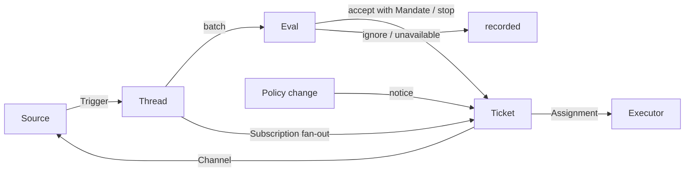

# 001 领域模型（001 Domain model）

> 来源：https://github.com/deepseek-ai/dsh-superagent-prototype/blob/main/docs/001-domain.md
> 原文：oss-repos/dsh-superagent-prototype/docs/001-domain.md
> 翻译日期：2026-11-03 ｜ 范围：全文 ｜ 方式：机器翻译初稿，未经人工校对
> 引用于：docs/essay-study/deepseek-super-agent-2026.md

本文为 dsh-superagent 的各个概念命名，并规定每个概念要遵守的规则。代码、agent 调用的工具、面板和其余文档统一使用这些术语，不用别的说法。承[000 哲学](000-philosophy.md)的原则，模型只保留工作真正需要的概念；一个业务需求会变成其中某个概念的属性。

## 流程（Flow）

工作从 Trigger（触发）流向 Eval（评估），再进入执行。Source（来源）产生 Trigger。一个 Trigger 以上下文的形式扇出（fan-out）给订阅了它所在 Thread（线程）的 Ticket（工单）。以这种方式抵达某个 Ticket 的人的消息归该 Ticket 所有；其余每个 Trigger 都进入 Eval，由 Eval 判断是否要开新工作。Eval 接单（accept）时会创建一个带 Mandate（授权）的 Ticket。Assignment（派工）把 Ticket 交给 Executor（执行器），结果再经 Channel（渠道）回到 Source。

## 概念（Concepts）

Source、Thread、Eval、Mandate 和 Subscription 构成核心领域，其余概念为它们提供支撑。

| 概念 | 定义 | 它遵守的规则 | 为什么需要它 |
| --- | --- | --- | --- |
| Source | 一条事件流。Source 的 kind 是可复用的实现；Source 实例是某个 kind 的一次配置：是否运行、监听什么 | 保存自己的读取位置和自身 bot 的身份。定义什么算一个事件，包括只有随时间推移才成立的条件。在 bot 自己的消息、以及监听范围之外的 Trigger 进入领域之前，先把它们丢弃。把每个 Trigger 翻译成它所属的 Thread，以及可以用来回复的 Channel 地址 | 重启不得重放事件 |
| Trigger | 一条不可变的事件，带着 Source 自己的元数据，例如它的 actor | 属于一个或多个 Thread。同一个 Trigger 被接受两次，只会创建一个 Ticket | 审计与幂等的单位 |
| Thread | 按时间排序的一串 Trigger；哪些 Trigger 构成同一个 Thread 由 Source 定义 | 同一时刻至多运行一个 Eval。可以承载多个 Ticket。持有它的 Subscription、正在运行的 Eval，以及 Decision（决定）历史 | 给 Eval 一个一致的视图和它的上下文 |
| Correlation | 同属一个 Trigger 的 Thread 之间的关系 | 只补充上下文，绝不用于路由 | 让 Eval 能跟随相关的证据 |
| Channel | Thread 的写入侧；其地址由 Source 定义 | 一个 Thread 可以有多个 Channel；Ticket 持有一组 Channel | 确认、回复、pull request 和已解决的 review 都是写入 |
| Policy | 带版本的评估规则，外加每个 Source 的那一部分：谁可以通过该 Source 发起工作、用该 Source 自己的哪些身份、名单如何同步、哪些 bot 可以产生候选 | Policy 版本涵盖规则、accept 模式和各 Source 的部分。影响到在办 Ticket 的变更（例如它当初据以接单的规则被改动）会投递给它的 Assignment；变更不会撤回 Mandate。不同 Source 上的身份永不互相映射 | 规则一变，正在运行的 Eval 必须作废 |
| Eval | 对一批 Trigger 的裁断，分两层：准入（gate）与研判（assessment） | 输入：Trigger 批次、一份 Thread 快照、该 Thread 上的全部 Ticket（含已结束的）、以及当前 Policy。输出：一个 Decision。自身不持有状态 | 决定新工作是否开始、是否继续、是否停止 |
| Mandate | accept 授予的东西：Policy 版本、范围、强度、命中的规则、发送者在该 Source 上的身份，以及 Source 是如何收到这个 Trigger 的 | 不可变；范围变宽意味着新开一个 Ticket。Ticket 结束并不终结它：只有人的 stop 才能撤回它，不再承载它的 Policy 会撤销它。已结束的 Ticket 恢复之前，要对照当前 Policy 重新校验 | 说明这项工作为什么可以做、能做多远 |
| Ticket | 一份被授权的工作 | 只有 Eval 能创建它。引用它的 Mandate；持有它的 Channel 和 Input。状态从 open 走向 ended；其 Thread 上的人的消息能让它回到 open，除非人已经 stop 了它。它自己定义状态，而不是跟随 Executor | 拥有这次执行及其报告 |
| Assignment | Ticket 与某个 Executor 实例的绑定 | 一个 Ticket 随时间可以有多个 Assignment。状态按 pending → running → ended 演进，与 Ticket 的状态彼此独立。只有它的最终报告可以在 Executor 一侧结束 Ticket | Executor 在领域之外，但"谁在执行"必须在领域之内 |
| Subscription | Ticket 与 Thread 之间的多对多关系，由 Thread 持有 | 匹配的 Trigger 会扇出给所有仍然存活的订阅 Ticket，不检查发送者是谁；以这种方式抵达 Ticket 的人的消息不经过 Eval。 Executor 为获取上下文而跟进的 Thread，其消息以同样方式抵达它的 Ticket，但既不借给它任何权威，也不恢复它。 已结束的 Ticket 保留它的 Subscription，包括那个已经关闭或合并的 pull request 的 Subscription：人的消息会在同一个 Mandate 下恢复它，无需 Eval 或 Decision；bot 和 CI 的消息到不了它，因为它的 Executor 恢复时会重新读它的 Thread。被人 stop 的 Ticket 什么都不接收。 主 Session 只有在消息明确指向某个 Ticket 时，才把 Thread 挂到该 Ticket 上。 人可以丢弃一个 Thread 上的全部 Subscription；Executor 只能丢弃自己的 Ticket 对它认为无关的 Thread 的 Subscription，例外是它的 Ticket 起始的 Thread，以及 Source 让它跟进的 Thread（例如它的 pull request 的 Thread） | 后续讨论无需再有人提及 agent，就能到达 Executor |

人不是领域概念。Trigger 携带它的 actor 的标识符，由 Source 给出。允许名单是 Policy 中属于某个 Source 的部分，用的是该 Source 自己的身份。同一个人在多个 Source 上都有账号，这属于 prompt 文本，agent 在需要时才会读到。

Executor 连同它的 Session 与目录都在领域之外，通过 Assignment 与领域相连。

聚合：Source 持有自己的读取位置。Thread 持有它的 Subscription、正在运行的 Eval（串行运行，期间到达的 Trigger 会并入下一批），以及 Decision 历史。Ticket 持有它的 Assignment、Channel 和 Input，并按 id 引用 Decision。

## 被否决的概念（Rejected concepts）

| 被否决的做法 | 理由 |
| --- | --- |
| 把 Principal 或 Membership 当作实体，或在 Source 之间映射身份 | 人是 Trigger 的元数据；允许名单是 Policy 中 Source 的部分；跨 Source 的映射是 prompt 文本 |
| 让 Eval 自己调度延迟的 Trigger | 需要等待的条件就是一个普通的 Source，因此 Eval 永不反向依赖 Source |
| Eval 的等待状态或撤销状态 | 等待属于 Source；超时的 Eval 会把它的 Trigger 重新入队，或者以 `unavailable` 结束 |
| 每个 Thread 至多一个存活 Ticket | 一个 Thread 可以承载好几件互不相干的工作；研判阶段靠 Ticket 列表去重 |
| 一种"追加到 Ticket"的 Decision | 追加就是 Subscription 扇出，不需要 Eval |
| 对 Subscription 做准入检查 | Subscription 覆盖整个 Thread；Mandate 把授权与上下文分开 |
| 会路由的 Correlation | 路由由 Subscription 负责；Correlation 只补充上下文 |
| 跟随 DSH Session 的 Ticket 状态 | Ticket 可以被移交、被恢复，或由多个 Executor 执行，所以它自己定义状态 |
| 让 Executor 声称"人让我停" | 只有 Eval 能决定一次结束的强度 |
| Policy 变更时取消正在运行的 Ticket | 取消会留下半截工作；变更改为被记录并投递出去 |
| Executor 的 Session 出错或受阻时锁死它的全部工具 | 那会连人在 Session 里直接操作、以及恢复之后的报告一并拒绝；只需暂停自动输入即可 |
| 从报告的自由文本推断"在等人" | 这种分类需要结构化事实；Executor 通过结构化字段来询问 |

## 可复用的部分（What is reusable）

上面这些概念及其规则是可复用的。Source 的实现、Policy 的内容、Executor 以及 Channel 的实现属于某次部署。每个 Source 内部保留自己的用词——比如消息、会话、通知——再把它们翻译成 Trigger。

| 部分 | 在本仓库中 |
| --- | --- |
| Source | 飞书：实时事件、历史补拉、订阅话题的轮询。GitHub：通知、订阅的 Issue 与 pull request、CI 变化、被合并或关闭的 pull request；开关打开后，还包括仓库中每个新的 Issue、pull request 和评论，以及默认分支的 CI |
| Policy | 评估规则，以及每个 Source 的允许名单、名单同步、bot 名单和准入表 |
| Executor | 每个 Ticket 一个 DSH 执行器 Session 和一个目录，运行在执行环境中，环境变量由 Executor 和各 Source 注册 |
| Channel | 飞书话题回复、GitHub 评论与 review 线程回复 |

## 术语表（Glossary）

本篇及后续文档所用术语及其中文名的参照表；上文没有引入的术语，由后续文档解释。面板一次只显示一种语言，它的 (?) 按钮会打开这份双语术语表。agent 在 GitHub 和飞书上发给人的消息用的是大白话，不是这些术语。

| 术语 | 中文 | 含义 |
| --- | --- | --- |
| Agent | 智能体 | dsh-superagent 运行的自动化团队成员，通过 GitHub 账号、飞书 bot 之类的身份在 Source 上行动 |
| Main Session | 主 Session | 评估 Trigger、接单并派发 Ticket、作出回复的 DSH Session；代码与 prompt 中写作 `orchestrator` |
| Executor Session | 执行器 Session | Executor 为某个 Ticket 运行的 DSH Session；代码与 prompt 中写作 `worker` |
| Source | 来源 | 一条事件流：插件提供的一个 kind，外加一份实例配置 |
| Trigger | 触发 | 来自 Source 的一条不可变事件 |
| Thread | 线程 | 按时间排序的 Trigger；Eval 在其中一次只运行一个的单位 |
| Correlation | 关联 | 共享同一个 Trigger 的 Thread 之间的关系；只补充上下文 |
| Channel | 渠道 | Thread 的写入侧 |
| Policy | 策略 | 接单规则的版本化集合，以及每个 Source 的那一部分，例如谁可以在那里派活 |
| Policy version | 策略版本 | 一组规则、Source 部分与 accept 模式的组合的标识；每个 Mandate 都记录它 |
| Eval | 评估 | 把一批 Trigger 变成一个 Decision 的过程 |
| Gate | 准入 | Eval 中确定性的第一层：谁可以发起工作、以多强的强度 |
| Assessment | 研判 | Eval 过程中模型作出的判断 |
| Decision | 决定 | Eval 的结果 |
| Mandate | 授权 | accept 授予的东西：强度、范围，以及它所依赖的 Policy 版本 |
| Ticket | 工单 | 一份被授权的工作 |
| Assignment | 派工 | Ticket 与某个 Executor 实例的绑定 |
| Subscription | 订阅 | Ticket 与 Thread 之间的关系 |
| Fan-out | 扇出 | 把订阅 Thread 的 Trigger 作为上下文投递给 Ticket |
| Executor | 执行器 | 运行 Assignment 的端口：每个 Ticket 一个执行器 Session 和一个目录 |
| Execution environment | 执行环境 | 执行器 Session 与 prepare 命令运行之处：由 Executor 和各 Source 注册的变量，每项含 key、value 和描述 |
| Report | 报告 | Assignment 向它的 Ticket 汇报的状态 |
| Attention | 待人工决定 | Ticket 上等待人回答的问题 |
| Disposition | 去向 | 一条 Trigger 被过滤、被评估或被扇出的记录 |
| Input | 输入 | 投递给 Ticket 的上下文：扇出的 Trigger、Policy 变更、恢复和文本 |
| Scope | 范围 | Mandate 允许的工作 |
| Strength | 强度 | Mandate 或 Eval 所依据的理由有多强 |

| 分组 | 取值 |
| --- | --- |
| Decision | accept 接单 · stop 停止 · ignore 忽略 · unavailable 未完成 |
| Strength | explicit 明确 · inferred 推断 |
| Assignment | pending 待启动 · running 执行中 · ended 已结束 |
| Report | progress 进展 · waiting 等待 · ready 就绪 · blocked 受阻 · failed 失败 · dropped 无需处理 |
