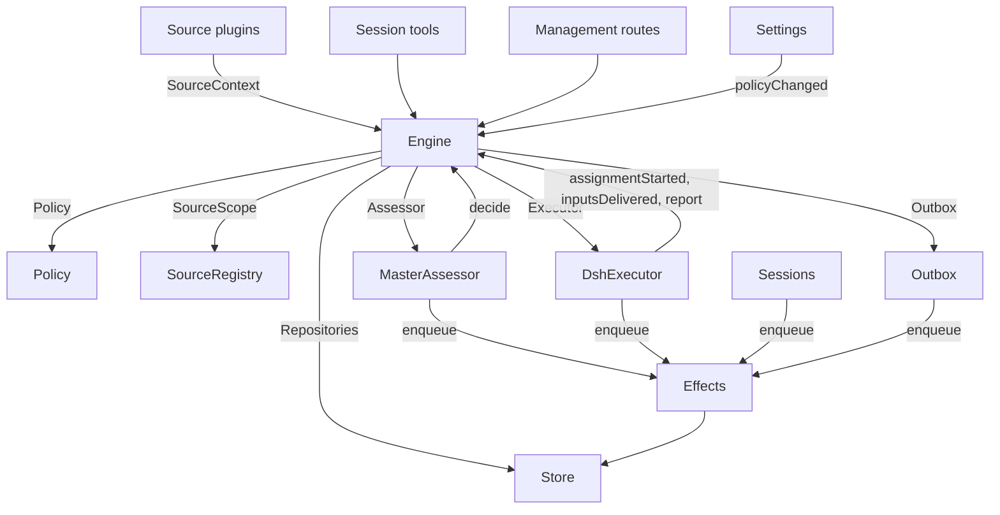

# 007 架构（007 Architecture）

> 来源：https://github.com/deepseek-ai/dsh-superagent-prototype/blob/main/docs/007-architecture.md
> 原文：oss-repos/dsh-superagent-prototype/docs/007-architecture.md
> 翻译日期：2026-11-03 ｜ 范围：全文 ｜ 方式：机器翻译初稿，未经人工校对
> 引用于：docs/essay-study/deepseek-super-agent-2026.md

这是面向开发者的实现指南。它把[001 领域模型](001-domain.md)到[006 部署](006-deployment.md)中的概念，映射到类、接口和文件上。先读运行时与 Engine，再把模块表和测试表当作代码索引使用。

## 目录

- [核心类与胶水层](#core-classes-and-glue)
  - [Runtime](#runtime)
  - [Engine](#engine)
  - [Model](#model)
  - [Policy](#policy)
  - [Store](#store)
  - [Effects](#effects)
  - [Sources](#sources)
  - [DshExecutor](#dshexecutor)
  - [MasterAssessor](#masterassessor)
  - [Settings](#settings)
  - [Prompts](#prompts)
  - [Sessions](#sessions)
  - [Glue](#glue)
- [依赖规则](#dependency-rules)
  - [面向具体 Source 的依赖](#source-specific-dependencies)
- [模块](#modules)
- [测试](#tests)
- [持久化](#persistence)
- [面向模型的接口](#model-facing-interfaces)
  - [主 Session 工具](#main-session-tools)
  - [预设与等待上限](#presets-and-wait-limits)
  - [执行器工具](#executor-tools)
  - [结果形状与研判上下文](#result-shapes-and-assessment-context)
  - [可读资源](#read-resources)
  - [投递给 Session 的消息](#messages-delivered-to-sessions)
  - [仅限面板的操作](#panel-only-actions)
- [配置热加载](#configuration-reload)
- [用真实数据复核改动](#reviewing-a-change-against-real-data)
- [未决问题](#open-questions)

## 核心类与胶水层

核心类在小接口的背后拥有领域概念和外部边界。胶水层把工具参数、HTTP 请求、Source 载荷和 DeepSeek Harness 事件翻译成对这些类的调用，再把结果变成卡片、视图和消息。

`Runtime`（`src/app/runtime.ts`）构造应用、提供依赖，并掌管启动与关闭。`Engine` 构造自己的内部部分。Executor 和 Assessor 会回调 Engine，所以 Runtime 给它们的是 getter，而不是要求按某种循环顺序来构造。

### Runtime

`Runtime` 是组合根（composition root），不含任何领域规则。它的构造函数锁定状态目录、打开 Store，并构建每个组件。构造失败时，它关闭 Store 并释放锁。

启动时会注册管理路由并运行 Setup。Setup 解析完成后，它安装 Session 与 Executor 的钩子、确保主 Session 存在、启动 Policy 同步、恢复被打断的 Assignment，并启动 pass 与 effect。`ready` 标志着启动完成。

关闭时会取消轮次、等待 pass、effect 和 agent、恢复进程环境、关闭 Store 并释放锁。Source 插件通过窄接口 `SourceHost`，把 Runtime 作为 `orchestrator` 服务注入。

| 部分 | 模块 | 职责 |
| --- | --- | --- |
| Setup | `src/app/setup.ts` | 按 worker shell 运行它们的方式去探测各自的 CLI，从而解析仓库和账号；写入并应用 worker 的环境与命令 shim，并保留 setup 问题；Settings 借它检查改动过的账号，也借它重启（重启会再跑一遍 setup） |
| Passes | `src/app/passes.ts` | 一次只跑一个 pass，每两秒一次，另有命令要求时也跑：先跑到期的 effect，再跑 `Engine.evaluateDue`；Source 的 Trigger 经由它到达 Engine |
| Outbox | `src/app/outbox.ts` | Engine 的 `Outbox` 端口，也是回执的唯一写入者：`send` 在一个事务里保存消息的回执并入队它的 `reply` effect，该 effect 的处理器再经 `SourceRegistry.send` 把消息发出；Source 关闭期间消息等待，会话消失或不再被监听时丢弃 |
| Notices | `src/app/notices.ts` | 把领域事件和 worker 的活动转换成主 Session 的消息。`eventNotice` 处理领域通知；`reportRelay` 立即转发问题、把普通进度留在它的 Ticket 上、转发其他报告；`followupRelay` 点名拥有某条人类 follow-up 的 Ticket。轮次期间到达的 relay，会在下一步经 DeepSeek Harness 的 inbox 一起投递 |

### Engine

`Engine`（`src/core/engine.ts`）是 Trigger、Thread、Decision、Ticket 和 Assignment 的唯一写入者。它从 `src/core/ports.ts` 收到这些端口：`Repositories`、一个取当前 Policy 的 getter、`SourceScope`、`Assessor`、`Executor` 和 `Outbox`。可选依赖是 `prepareTicket`、`now` 和 `emit`。

Engine 的所有方法都是同步的。每个命令在一个事务里改动它的聚合。`evaluateDue` 对它改动的每个 Eval 或 Ticket 各用一个事务。端口在事务内部入队外部工作；适配器在提交之后执行它。无效请求抛出 `UserError`。

Engine 暴露一个入口，并委派给五个内部部分。它掌管每个命令的事务。跨部分的命令（例如 `attach`、`evaluateDue` 和 `policyChanged`）按顺序调用各个部分。

每个部分继承 `EnginePart`（`src/core/part.ts`），它提供选项和共享的读取。各部分之间的依赖单向流动：

| 部分 | 职责 | 依赖 |
| --- | --- | --- |
| `Intake` | Source 的 Trigger：连同它的去向只存一次、记录到它的 Thread 及其 Correlation 上、扇出给订阅的 Ticket；并且——除非它是一条已经抵达某个 Ticket 的人发的消息——在它的主 Thread 上入队等待 Eval | Tickets |
| `Evals` | Thread 的 Eval：分批、准入给出的强度、连同给出这些值的 Trigger（`primary`）一起的 actor 与依据、从候选投递起算的截止时间及其因暂停而做的位移、超时 Eval 的重新入队、候选、重放与交还、Policy 变更时的重新入队，以及每个 Eval 结束时给出的 Decision：accept、stop、ignore 或 unavailable（注：代码实现为五值，含 reopen，见 model.ts:190） | Tickets |
| `Tickets` | Ticket 的生命周期：由 accept 创建（连同它的 Mandate、Subscription 和第一个 Assignment）、它跟踪的 Thread 及其关闭（`followsDone`）、挂上的 Thread 与仅为上下文跟进的 Thread、Input 与备注、恢复以及恢复所拒绝的消息、重试、重启、stop 与结束、它丢弃的 Subscription，以及对受它影响的 Ticket 发出 Policy 变更通知 | Replies |
| `Assignments` | Executor 及其 worker 汇报的东西：Assignment 已启动、Input 已抵达或投递失败、重启打断了它，以及 worker 的 Report 连同它向人提出的问题 | Tickets, Replies |
| `Replies` | 经 `Outbox` 的 Channel 写入：确认、回答、结果和待人工决定的消息，各自依照允许它的那条规则 | Nothing |

命令使用 `stopTicket` 这样的祈使名；适配器报告的事实使用 `assignmentStarted` 这样的过去式名。查询 `candidate` 用名词。

调用者只拿到自己角色对 Engine 的 `Pick`：`EngineForSources`、`EngineForMainSession`、`EngineForPeople`、`EngineForSettings` 或 `EngineForExecutor`。

| 角色 | 方法 | 效果 |
| --- | --- | --- |
| Sources | `receive(trigger)` | Trigger 只存一次，没有 Source 接收它时回答 `stored`、`duplicate` 或 `filtered`；把它扇出给订阅其 Thread 的 Ticket——在那里，人发的消息会立刻恢复已结束的 Ticket，除非处理被暂停——并在它的主 Thread 上入队等待 Eval，除非它是一条已经抵达某个 Ticket 的人发的消息，那样它就归那个 Ticket 所有 |
| Sources | `bindThread(ticketId, thread, own)` | 让一个 open 的 Ticket 跟踪该 Source 的某个 Thread（例如某个 pull request 的）；Ticket 自己开的那个记 `own`。已关闭的 Thread 再次绑定就重新变为 open。结束 Ticket 的是这些 Thread 的关闭，而不是 `ready` 报告 |
| Sources | `threadClosed(thread, outcome, at)` | 一个 Thread 关闭了：跟踪它的每个 open Ticket 记录这次关闭，并在它跟踪的 Thread 都了结时（`followsDone`）结束——它开的 Thread 没有还开着的；或者，当它一个也没开时，它跟踪的每个 Thread 都已关闭。它按这些关闭中最近的一次，以 `merged` 或 `closed` 结束；除非关闭之后恢复的工作尚未报告 `ready`，或者它的 Executor 已经以确认或回答的方式，接手了它在最新 Report（`progress` 除外）或上一轮结束之后判定的某条人类 follow-up——那种情况下，一份 `dropped` 报告就按那次关闭的方式结束它 |
| Main Session | `candidate(triggerId)` | 持有某条 Trigger 的 Eval，在它的研判者看来的样子 |
| Main Session | `candidateDelivered(evalId)` | Eval 的候选抵达了主 Session：它的截止时间从此刻起算 |
| Main Session | `decide(triggerId, outcome)` | 记录一个 Eval 的 Decision，或为 explicit 请求记录一个直接的 Decision。accept 会原子地创建 Ticket、Mandate、Assignment、Subscription 和确认。一个从卡片直接 ignore 的 inferred 候选，在给出的理由之前记录 `ignoredFromCard`。只要 `followupOwners` 还拥有某条人类 follow-up，就只允许 stop |
| Main Session | `attach(ticketId, triggerId, note?)` | 把 Trigger 路由到它指向的 Ticket，其 Executor 随后把它当作 follow-up 来判断，并结束持有它的 Eval——Eval 里的其他 Trigger 等待一次全新的 Eval；已结束的 Ticket 会在它的 Mandate 下立刻恢复，除非处理被暂停。仍由某个 Executor 判断的 follow-up 会被拒绝，被路由回把它交还出来的那个 Ticket 的 follow-up 也会被拒绝 |
| Main Session | `requestStatus(ticketId)` | 向一个等待中的执行器 Session 询问状态，并回答它是否问过 |
| Main Session | `note(ticketId, text)` | 把来自其他工作的一条事实作为文本 Input 交给 Ticket 的 Executor，不授予任何东西 |
| Main Session、Executor | `reply(request)` | 为这条消息的目的所指的 Channel 入队一条消息：`acknowledgement`、`answer`、`result` 或 `attention` |
| People | `stopTicket(ticketId, reason?)` | 人的 stop，撤回 Mandate |
| People | `retryTicket(ticketId)` | 结束一个卡住的 Assignment 并开一个新的：该 Ticket 因 `failed` 或 `blocked` 报告而在等人，或它的 Input 投递失败（`canRetry`） |
| People | `reevaluate(triggerId)` | 把存储的 Trigger 入队，等待一次全新的 Eval |
| People | `unsubscribe(thread)` | 丢弃一个 Thread 上的全部 Subscription，跟踪它的 Ticket 不再跟踪它；各自继续判断它们在那里收到的 follow-up |
| People | `dismiss(decisionId)` | dismiss 一个 `unavailable` Decision 显示的问题，Decision 会记录这次 dismiss |
| Executor | `assignmentStarted(ticketId, assignmentId)` | 一个 Assignment 在运行；它等待的 Input 发出去 |
| Executor | `inputsDelivered(ticketId, assignmentId, inputIds)` | Input 抵达了 Assignment 的执行器 Session，每条在那里等待某一步取走 |
| Executor | `inputsRead(ticketId, inputIds)` | 执行器 Session 把承载这些 Input 的消息纳入了它的历史（一个 `user/message` Session 事件），模型由此拿到它们；认领了它们、却在进入历史之前被取消或失败的那一步不算。每条只要随后来了 Report 或一轮结束就算已读，重启之后也一样，它的 Ticket 结束也不会放手；在读取记录之前投递的 Input，只要投递之后来了 Report 或一轮结束就算已读 |
| Executor | `turnEnded(ticketId, assignmentId)` | 执行器 Session 的一轮结束了，出了 Report 之后也一样——只要它后台没有还在跑的东西、或者已经移交给人。之前某一步取走了什么，它就读了什么（`inputsRead`） |
| Executor | `deliveryFailed(ticketId, assignmentId, error)` | 投递 Input 失败；Ticket 会一直显示它，直到一次投递成功、一个新的 Assignment 开始或 Ticket 结束 |
| Executor | `report(ticketId, report)` | 记录一份 Report 及其向人提出的问题；`dropped` 结束 Ticket，`ready` 完成一个不跟踪任何 Thread 的 Ticket，也结束一个它跟踪的 Thread 已了结的 Ticket |
| Executor | `markUnrelated(ticketId, thread, reason)` | 只丢弃该 Ticket 对一个它认为无关的已挂上 Thread 的 Subscription，并连同理由交还该 Ticket 判断的那些 follow-up |
| Executor | `followForContext(ticketId, thread)` | 让一个 open 的 Ticket 订阅一个相关 Thread 以获取上下文：它的消息抵达 Ticket，但不借给它跟进强度，也不恢复它 |
| Executor | `handback(ticketId, triggerId, reason)` | 记录该 Ticket 交还一条抵达它的 Trigger，带上它的候选携带的理由，并在没有别的 Ticket 判断它时（如果这个 Ticket 曾判断过）把它入队等待一次全新的 Eval；它回答是否入队。一个 Ticket 对每条 Trigger 只交还一次，并保留它的 Subscription |
| Executor | `assignmentInterrupted(ticketId, assignmentId)` | 宿主停止时一个 Assignment 正在运行：工作中途被打断的，或在最新 Report 之后收到过 Input 的，会带着恢复说明、以及投递给它而其执行器 Session 没有取走的 Input 重新开始，就像一次重试那样；此后报告过的保留它的 Session。DshExecutor 在启动时逐个报告它们（`resume`），从最老的 Ticket 开始，并把等待中的启动重新入队 |
| Passes | `evaluateDue()` | 除非处理被暂停：启动那些排队 Trigger 在等待的 Thread 的 Eval，每个 Thread 一个，期间入队的 Trigger 作为一个批次；把超过截止时间的 Eval 的 Trigger 再次入队，连续两次，第三次记为 `unavailable`；并恢复在暂停期间被人发的消息抵达的已结束 Ticket，前提是它们的 Mandate 当时仍然成立。候选尚未抵达主 Session 的 Eval 不会过期。处理暂停期间没有 Eval 会过期，恢复之后每个截止时间都按暂停的时长后移 |
| Settings | `policyChanged(from, to, effects)` | 告诉每个受这次变更影响的在办 Ticket 它以何种方式受影响（`src/policy.ts` 中的 `policyEffects`：它据以接单的规则变了或不再适用、它的请求者不再能开工、或主动工作不再被接单），并在新版本下重启进行中的 Eval |

Engine 把分批、授权、扇出、恢复和待人工决定的生命周期规则都保持为私有。几个共享的谓词让这些规则保持一致：

- `waitsForPerson`（`src/core/model.ts`）：最新的 Assignment 报告了 `blocked` 或 `failed`，且此后没有人类消息到达。为真期间，自动 Input 和失败的启动仍被扣着。
- `followupOwners`：仍对发在自己 Thread 上的某条人类 follow-up 负责的 Ticket。Ticket 可以是存活的，也可以是已结束但没有被人 stop、正等待恢复的。把消息交还出去就结束这份归属。
- `settled`：某个 Decision 已经了结了这个请求；stop、unavailable、已路由和被拒绝的 stop 这些 Decision 不算数。
- `ticketStage`（`src/core/stage.ts`）：实现[003 执行](003-execution.md)中的阶段表。

Ticket 结束时，未读的 follow-up 回到 Eval，除非另一个 Ticket 仍拥有它们、或另有去向已经了结了它们。已确认、已回答、已交还的消息除外。对于没有确认去向的旧记录，Outbox 的回执提供这个事实。一份最终 Report 还覆盖 Assignment 开始时就在等待的消息，包括恢复它的那条消息。stop 了 Ticket 的那条消息不会被自动重新评估。

变更之后，Engine 从 `src/core/ports.ts` 的 `DomainEvents` 发出事件：

`trigger.received`、`eval.started`、`decision.recorded`、`ticket.created`、`ticket.resumed`、`ticket.ended`、`assignment.started`、`assignment.ended`、`thread.subscribed`、`thread.unsubscribed`、`trigger.requeued`、或 `policy.changed`。

Runtime 把 `ticket.ended`、`trigger.requeued` 和 `thread.unsubscribed` 变成通知。一条投递给 Ticket 的人类 `trigger.received` 会变成一条 follow-up relay。当 Ticket 以 merged 或 closed 结束时，`pullEndNotices` 用一个稳定的 id 发送一条聊天通知。其他事件目前没有消费者。

### Model

`src/core/model.ts` 保存领域类型，`src/core/stage.ts` 保存 Ticket 阶段。Decision 把理由记为 `reason`，即一个 `Reason` 列表（`src/core/reasons.ts`）：每项是一个 `code` 连同它的 `values`，对于批次中的某条 Trigger 还有它的 `triggerId`。

核心的 code（例如 `timeout`、`policyChanged`、`routed` 和 `startedTicket`）是 `REASONS`，配合 `reasonText` 给出 agent 读到的英文；准入或 Source 范围会给出自己的 code，例如 `not_a_member`；而 `said` 承载研判者或人写下的原话。面板按 `reason.<code>` 给每个 code 配文案，被某个 Source 过滤掉的 Trigger 也以同样方式记录该 Source 的 code。

Ticket 每条事实只存一次。只要它还没有 `ended`，它就是 open 的；`ended` 记录何时、被谁、为什么、以什么结果结束。它最后说了什么，就是它最新的 Assignment Report（`latestReport`）；它的执行器 Session 以它命名（`src/executor/dsh.ts` 中的 `workerSessionId`）。

它的字段都是带类型的：`origin`——给出该 Eval 批次强度、以及批次本身的那条可接受的 Trigger（`triggerId`、`triggerIds`）；`execution`——Executor 选择的东西（`name`、`directory` 和 `assignment`）；`delivery`——最近一次失败的 Input 投递（`error`、`at`），直到一次投递成功、新的 Assignment 开始或 Ticket 结束；以及 `follows`——Source 让它跟踪的 Thread，每项为 `{thread, own, closed?}`：Ticket 自己开的记 `own`，关闭后带 `at` 和 `outcome`。只有 Tickets 会写 `follows`；GitHub Source 用 `pullsOf` 和 `pullOf`（`src/sources/github-pull.ts`）读它的 pull request。

携带 Trigger 的 Input 会记录它是否由人写成，`waitsForPerson` 会读这个。Thread 还会在 `context` 里列出那些只为上下文而跟踪它的订阅 Ticket，并在 `expired` 里统计它的排队 Trigger 连续过期的次数；一次 Evaluation 记录它的 `primary` Trigger，以及它的候选何时 `delivered`。

Trigger 的去向记录它抵达了哪些 Ticket（经扇出或挂载）、人的重新入队、每个把它交还出来的 Ticket（连同理由）、以及每个其 Executor 确认或回答了它的 Ticket。

Mandate 的 `basis`（`MandateBasis`）记录准入是如何放行它的 Trigger 的。重新校验会读取接收方 `source`、`scope` 和 `row`、在名单上的 `sender`、命中的 `rules`，以及 `via`：

| `via` | 准入依据 |
| --- | --- |
| `addressed` | 一个获准的发送者对 agent 说话 |
| `followup` | 一条消息到达了有 Ticket 的 Thread |
| `admission` | 准入表的某一格；`observation` 标记 inferred 候选 |
| `bot` | 名单上的 bot 产生了一个 inferred 候选 |

Trigger 和 Thread 的 `meta` 属于 Source。核心不解释它们。

### Policy

`src/policy.ts` 定义设置的 schema、授权规则和评估规则。`settingsPolicy(settings, scope)` 每次使用都返回一个全新的、无状态的 `Policy`：

- `version`、`paused` 和 `evalTimeoutMs` 描述它的当前状态。
- `gate(trigger, thread, tickets)` 返回准入的强度和依据。
- `revalidate(mandate)` 检查一个既有 Mandate 是否仍然成立。
- `admitsInferred(rules)` 只在 auto 模式且命中规则已启用时，允许主动接单。

`assessmentOutcome(assessment, settings, strength)` 把模型的研判转换成 Engine 的结果。它要求对每条启用的规则都有判断、方向已确定、有一条命中规则，并且有意向的证据。在 auto 模式之外，一个 inferred 的 accept 变成一条"would accept"的记录。

`policyEffects(tickets, old, now, scope)` 找出哪些 open Ticket 受这次变更影响、以及如何受影响。`Engine.policyChanged` 只通知那些 Ticket。`policyVersion` 对规则、accept 模式和各 Source 的 Policy 部分（含 bot 名单）做哈希。

### Store

`Store`（`src/app/store.ts`）拥有一个 SQLite 数据库。Runtime 在打开它之前获取目录锁，防止第二个进程迁移或写入同一份状态。

它的接口按用途分组：

- **领域仓库：**`atomic`，外加 `triggers`、`threads`、`tickets` 和 `decisions`，每个都有 `get`、`save` 和列表查询。带索引的工作集是 `threads.active()`、`tickets.open()`、`tickets.active()` 和 `read.subscribedThreads`。
- **读查询：**`read` 通过 `threadTriggers`、`triggerStats`、`search` 和 `droppedReplies` 之类的方法服务视图、工具和 Source 轮询。这些方法从不写。
- **Source 元数据：**`threads.describe` 和 `threads.patchMeta` 更新归 Source 所有的 Thread 元数据。
- **设置：**`settings`、`saveSettings`、`blockRevision` 和 `settingsHistory`。设置与 prompt 使用带编号的 `Versions`（`src/app/versions.ts`）。
- **Outbox 回执：**`replyStatus` 和 `receipts`，只由 Outbox 写入。回执操作是 `get`、`waiting`、`behind`、`add`、`settle` 和 `withdraw`。`behind` 检查同一 Ticket、同一会话是否有一条更早的消息在等待、且失败不足三次。被撤回的消息以 `channelGone` 或 `channelIgnored` 结算。读查询通过 `failingReplies`、`droppedReplies` 和 `droppedSince` 暴露失败与被丢弃的回复。
- **带类型的键值记录：**`get`、`set`、`delete` 和 `keys`，使用 `KV` 中的条目。

`afterCommit` 只在事务提交之后运行一个动作，回滚之后绝不运行。Runtime 按存储时的形状读记录；schema 11 的迁移会在启动时转换受支持的旧记录。

### Effects

`Effects`（`src/app/effects.ts`）是持久的副作用队列。命令在事务内调用 `enqueue(kind, key, payload)`；执行只在提交之后开始。

每个 kind/key 对只有一行。入队同一个等待中的 key 会替换它的载荷，并让它立刻到期，而不改变队列顺序。`handle(kind, run, options)` 为每个 kind 注册一个处理器。它按最旧优先处理到期的行，受并发上限限制。

失败按指数退避重试。抛出 `Later` 会推迟工作而不计一次失败，例如没有空闲 worker 槽位时。`start` 在 setup 之后开始处理，`drain` 在关闭时停止处理同时保留挂起的行，`pending`/`idle` 暴露队列状态。

| Kind | 处理器 | 职责 | 立即执行上限 | 重试 |
| --- | --- | --- | --- | --- |
| `assessment` | MasterAssessor | 把 Eval 的候选卡片引导进主 Session 的轮次，然后告诉 Engine 它已投递，由此启动 Eval 的截止时间 | 4，暂停期间为 0 | 2 秒起翻倍到 60 秒 |
| `launch` | DshExecutor | 启动一个 pending 的 Assignment：prepare 命令、执行器 Session、assignment 消息 | 空闲的 worker 槽位数，暂停期间为 0 | 模型服务商或网络的偶发失败 5 秒后重试、翻倍到 300 秒，共三次；其他任何失败，以及失败的 prepare 命令，都会让它的 Ticket 失败。被暂停或被 worker 槽位占满扣住的，5 秒后重试 |
| `delivery` | DshExecutor | 按顺序把 Ticket 等待中的 Input 交给它正在运行的 Assignment | 4，暂停期间为 0 | 2 秒起翻倍到 60 秒；等待 worker 槽位的 2 秒后重试 |
| `relay` | Sessions | 把 worker 的报告或问题、或人的 follow-up，引导进主 Session 的轮次 | 1，按队列顺序 | 2 秒起翻倍到 60 秒 |
| `notice` | Sessions | 把一条通知注入主 Session，而不唤醒它 | 1，按队列顺序 | 2 秒起翻倍到 60 秒 |
| `reply` | Outbox | 经 Source 发送一条属于某个 Channel 的消息，排在该 Ticket 发往同一会话、尚未失败三次的更早消息之后；撤回这条消息会取消它 | 1，暂停期间为 0 | 5 秒起翻倍到 300 秒；Source 关闭的、或排在更早消息之后的，5 秒后重试 |

每个 kind 都有一个以它名字命名的健康项。某项 effect 连续失败三次后它就报错，`delivery` 例外——它的失败显示在自己的 Ticket 上。relay 保持顺序，通知也一样；某一条失败会压住同类中在它之后的消息。

### Sources

Source 通过 `src/sources/kind.ts` 中定义的 `SourceKind` 扩展宿主。一个 kind 声明它的身份、标题、描述、配置 `schema` 与 `fields`、派生的 `facts`，以及 `health` 条目。可选行为包括 `scope`、一个 `channel`（`allowed`、`send`、`link`）、`threadContext`、`find`、`policy`、`environment` 和 `refreshLabels`。

`SourceRegistry`（`registry.ts`）拥有已注册的 kind 和已存储的实例，并实现 Engine 的 `SourceScope`。注册会在 `HealthBoard` 上认领健康条目；重复认领和保留名 `sync:` 会被拒绝。SourceContext 只能通过它注册时认领的条目写入，所以注销之后的报告不产生任何效果。

Registry 的配置方法包括 `kind`、`instances`、`instance`、`validate`、`validatePolicy`、`policyPart`、`channelAllowed`、`declarations`、`environments`、`find` 和 `scope`。`find` 会询问每个支持搜索的 kind。

通用代码经由 registry 访问 Source 的行为。`send(message, commands)` 调用该 kind 的 Channel，若该 kind 未安装则返回 `sent`、`gone` 或 `waiting`。`link` 解析它的 Channel 链接。`threadContext` 把某个 kind 的读取器与它的配置配对，该 kind 没有读取器时返回空。存储的配置无效会禁用该实例。

插件收到 `SourceHost`：registry 和 `context(kind)`。kind 本身使用更窄的 `SourceContext`，由 `src/app/source-context.ts` 中的 `sourceContextOf` 构建。

该上下文提供部署与命令、setup 就绪状态（`ready`、`configured`、`problem`）、配置、`receive`、`atomic`，以及带类型的 `state`。它还暴露 Thread 的读取与元数据写入、Ticket 的读取与绑定/关闭命令、Trigger 的读取、经 Outbox 的 `notify`，以及为已声明的健康条目准备的 `report`。

### DshExecutor

`DshExecutor`（`src/executor/dsh.ts`）为每个 Ticket 提供一个 Session 和一个目录。`start` 和 `deliver` 入队 `launch` 和 `delivery` effect。`stop` 经 `Store.afterCommit` 取消轮次，所以被回滚的结束不会停掉 worker。

`prepare(ticket, outcome)` 提供 Engine 的 `prepareTicket` 钩子：短名、目录和 `ticketExecution` 的 assignment 文本。`workerSessionId(ticket.id)` 派生 Session id。

`WorkerSlots` 在启动之前、或唤醒闲置 worker 的投递之前预留容量。人类消息可以用 `maxWorkers` 之外的一个槽位，唤醒优先于启动。`activeCount` 提供面板上的负载。

临时的 provider 和网络故障重试三次。启动使用 effect 的退避；失败的轮次在 15、30、60 秒后收到继续的指示消息。`inputMessage` 从当前 Ticket 状态渲染每条 Input，`mandateInstructions` 为 inferred 工作加上命中规则的限制。

`install` 订阅 Session 事件；`dispose` 取消订阅。轮次结束通常报告等待，就绪之后或需要人出手时除外。出错报告 failed。启动时，`resume` 经 `assignmentInterrupted` 报告被打断的 Assignment，并把不等人的 pending 启动重新入队，从最老的 Ticket 开始。

### MasterAssessor

`MasterAssessor`（`src/app/assessment.ts`）让主 Session 能研判主动候选。`request` 入队一个研判 effect；`release` 在它的 Eval 结束时丢弃缓存状态。

它的 `context`、`read` 和 `decide` 方法服务 `orchestrator_eval`、`orchestrator_eval_read` 和 `orchestrator_eval_decide`。它们经 `SourceRegistry.threadContext` 提供有界的 Thread 上下文、仓库上下文，以及决定的提交。没有上下文读取器的 kind 只提供 Trigger 和批次。

`assessmentOutcome` 把模型的回答转换给 `Engine.decide`。Evals 会再对着当前 Policy 复核 inferred 的接单。

### Settings

`Settings`（`src/app/settings.ts`）读写带修订号的设置块。`current` 和 `view` 读它们；`save(block, value, revision, origin)` 校验一次保存；`pause(paused, origin)` 改动单独的 `paused` 设置。

每次保存都声明它的来源：`panel`、`tool` 或 `sync`。只有 `panel` 能改执行环境或 `SETUP_FIELDS`（`src/deployment.ts`）中列出的字段。

Policy 版本变更会计算 `policyEffects`、记录哪些 Ticket 被通知过，并调用 `Engine.policyChanged`。`syncable` 和 `sync(id)` 刷新某个 Source 的 Policy 部分。`refreshLabels(id)` 刷新显示名。

### Prompts

`Prompts`（`src/app/prompts.ts`）把配置存为 `Versions`。`current`、`version` 和 `history` 读它们；`validate`、`preview` 和 `save(value, baseRevision, source)` 校验并保存；`compose` 和 `skills` 构建 Session 文本。

`builtInParts` 列出可覆盖的 key、角色、默认文本和必需的模板占位符。每个覆盖项保存团队的 `text` 和一个 `base`：即其原始默认值的 `builtInBase` key。保存时会把该默认值保留在 `KV.prompts.builtIn` 下。`defaultChanged` 随后报告变更过的默认值、可用时它们的旧文本，以及被移除的部分。

校验时，省略的 base 从已保存的覆盖项继承；已保存数据中出现过的被删部分会被丢弃；空白文本或其他未知 key 会被拒绝。这样保存工具就能把它读到的配置原样写回。`environmentSection` 和 `policySection` 只替换一次模板值，且只用自己的 key。没有覆盖项的配置使用默认值。

### Sessions

`Sessions`（`src/app/sessions.ts`）为两个角色管理 DeepSeek Harness Session。`ensure` 用该角色的模型创建 Session。`install` 跟随 agent 事件，并为受管理的 Session 注册 prompt、skill 和工具。

`prompt` 每个请求 id 只投递一次。`relay` 和 `notify` 入队主 Session 的消息，由 `relay` 和 `notice` effect 处理。`src/app/notices.ts` 定义它们的内容；`delivery` 检查一条消息是否到达。

每次模型请求都把 Session 绑定到当前的 prompt 修订。它用过的修订被持久保存：`promptVersion` 标识当前生效的那个，`mayRead` 限制 worker 可以查看哪些版本。注册情况按每个 agent 一张 map 跟踪。

`status` 和 `promptVersion` 服务 prompt 页面。保存经 `Prompts.save` 并通知主 Session。`modelRetry` 暴露模型预算的重试状态。

### Glue

| 胶水层 | 翻译什么 |
| --- | --- |
| `src/app/runtime.ts` | 组合根：按各部分使用的接口构建它们，注册路由与 Source 宿主，并启动、停止 dsh-superagent |
| `src/app/notices.ts` | 领域事件和 worker 报告，变成给主 Session 的通知与 relay |
| `src/app/tools/main.ts`、`src/app/tools/executor.ts` | 主 Session 与执行器 Session 的工具参数，变成对核心类的调用；以及它们的结果，变成卡片 |
| `src/app/http.ts`、`src/app/views/`、`src/app/api.ts` | HTTP 请求变成调用，Store 的读取变成面板的视图；`api.ts` 为面板给每条路由标注类型 |
| `src/app/resources.ts`、`src/app/links.ts`、`src/app/cards.ts` | 资源名变成读取，来源消息变成链接，记录变成给模型的紧凑卡片 |
| `src/sources/github*.ts`、`src/sources/feishu*.ts`、`src/sources/poll.ts` | GitHub 与飞书的载荷变成 Trigger 和 Thread 事实，消息变成 CLI 调用 |
| `src/deployment.ts`、`src/setup.ts`、`src/infra/` | Setup 的探测与问题、CLI 传输、agent 的进程环境 |

## 依赖规则

- **显式、窄的依赖。**每个类收到一个指名它所用之物的接口，多半是其他类的 `Pick` 类型：核心类用 `ExecutorHost`、`AssessorHost`、`SessionsHost`、`SettingsHost`、`SetupHost`、`PassesHost` 和 `OutboxHost`；胶水层用 `HttpHost`、`MainToolsHost`、`ExecutorToolsHost`、`ResourceHost`、`LinkHost` 和 `SourceContextDeps`；调用 Engine 的一方拿到的 Engine 是其角色的 `Pick`。Runtime 只在这种接口背后把自己传出去。Source 插件注入 `orchestrator` 服务，它的类型把它命名为 `SourceHost`：registry 和 `context(kind)`；其 kind 的代码只看到它的 `SourceContext`。
- **谁可以 import 谁。**`src/core` 除 Node 的哈希之外不 import 任何自身之外的东西，也不做任何 I/O。`src/sources` 不从 `src/app` import 任何东西。面板只从宿主侧 import 类型，以及 `src/admission.ts`、`src/limits.ts`、`src/setup.ts`、`src/navigation.ts`、`src/sources/host.ts`、`src/core/errors.ts`、`src/core/reasons.ts` 的纯值，和 `src/app/api.ts` 的过滤列表。
- **每种状态只有一个写入者。**每类状态只有一个写入者，其余部分读它，或去问那个写入者。

  | 状态 | 写入者 |
  | --- | --- |
  | Trigger、Thread、Decision、Ticket、Assignment | Engine |
  | Source 的读取位置，以及它在自己 Thread 上保留的 meta（`label`、`url`、`facts` 和它自己的 key） | 该 Source，经 `SourceContext` |
  | 设置及其历史 | Settings |
  | Prompt 修订 | Prompts |
  | Effect 行 | Effects |
  | Outbox 回执 | Outbox：Engine 的消息和 Source 的 `notify` 经它的 `send` 发出，它的 `reply` effect 负责标记 |
  | 健康条目 | 在 `HealthBoard`（`src/infra/health.ts`）上认领它的那个部分，它拒绝第二次认领：`runtime` 属 Runtime（Passes 经它报告）、`evals` 属 Runtime（每轮 pass 之后）、`models` 属 Sessions、每个 effect kind 属 Effects、`worker` 属 DshExecutor、某个 Source kind 的条目属该 Source 的 SourceRegistry、`sync:<id>` 属 Settings |

  Source 只能经 `SourceContext.tickets.bindThread` 和 `threadClosed` 改动 Ticket，这两个方法调用 Engine。
- **请求与事实。**索要东西的方法用祈使动词加宾语命名，例如 `stopTicket` 或 `bindThread`，可能被拒绝；记录适配器做了什么的方法用过去式命名，例如 `assignmentStarted` 或 `deliveryFailed`。每个宿主收到的 Engine 是它需要的那个角色类型。
- **带类型的字段，Source 数据归 Source。**代码读取 Ticket 和 Mandate 的带类型字段。Source 在 Ticket 上什么都不留：Ticket 跟踪 Source 的哪些 Thread，是 Ticket 的 `follows`；它关于某条 Trigger 或 Thread 保留的东西，在它们各自的 `meta` 里。
- **固定的拒绝。**人或 agent 可以触发的拒绝，是 `src/core/errors.ts` 中 `USER_ERRORS` 里的一个 `UserError(code, values)`。管理 API 对 `missing` code 回 404，其余回 400，面板按自己的语言给每个 code 配文案。Setup 问题是 `SetupError` code（`src/setup.ts`），固定的健康文案是 `HealthCode`（`src/sources/host.ts`），措辞方式相同。

### 面向具体 Source 的依赖

有些通用模块仍然直接提到 GitHub 或飞书：

- Outbox 施加飞书群聊的字数上限。
- `src/app/links.ts` 解析飞书消息链接和 `repliedTo`。它和 Runtime 用 `feishuSettings` 读设置。
- `src/app/resources.ts` 读 `feishu/` 和 `github/` 的原始记录；`src/app/cards.ts` 用 `pullOf` 生成 Ticket 卡片。
- Runtime 为已合并或已关闭的 Ticket 发送 `pullEndNotices`。
- 执行器工具用 `readPull` 和 `claimPull` 绑定被报告的 pull request，使用 Runtime 暴露的 GitHub 上下文。
- MasterAssessor 用 `readRepositoryPath` 读仓库文件。
- Sessions 和 Prompts 只为 GitHub 和飞书注册内置 skill。迁移会转换它们 schema-10 的记录。
- Setup 只探测 GitHub 和飞书的账号字段（`SETUP_FIELDS`）。只有这些 Source 经 `SourceContext.problem` 收到账号的 setup 问题。

## 模块

| 路径 | 职责 |
| --- | --- |
| `src/index.ts` | 主插件入口：读机器设置、启动 Runtime，并给它一个重启——保存某个 Source 的账号时用的就是这个重启 |
| `src/deployment.ts` | 插件的 `Config` 和 `Machine`；`resolveDeployment` 和 `resolveFeishuBot` 从 Source 设置读取仓库和账号，每个 CLI 都按 Executor shell 运行它的方式来跑；`SETUP_FIELDS` 列出 setup 会读的 Source 字段。代码不指名任何人、账号或组织 |
| `src/setup.ts` | Setup 问题：`SetupError`，含一个 code、修复它的地方，以及日志、主 Session 和面板共用的英文文案 |
| `src/policy.ts` | Policy：按块划分的设置 schema、Policy 版本、准入与 Mandate 重新校验 |
| `src/admission.ts` | 准入表的取值、每格的选项与默认值，与面板共用 |
| `src/limits.ts` | 人所设置取值的上限，设置 schema 检查它们，面板的字段提供它们 |
| `src/kv.ts` | `KV`：`kv` 记录的每个族，连同它的 key、值的类型和归属者，以及 Store 与 `SourceContext.state` 采用的 `Key` 和 `Family` 类型 |
| `src/navigation.ts` | 在宿主的目录列出某个 DeepSeek Harness Session 之后，从面板打开它 |
| `src/core/model.ts` | 领域类型，其中包括带类型的 Ticket 和 `MandateBasis`，以及 `threadKey`、`ticketOutcome`、`reached`、`followupOwners`、`settled`、`waitsForPerson`、`liveTicket`、`runningAssignment`、`latestAssignment` 和 `latestReport` |
| `src/core/ports.ts` | 各端口：`Repositories`、`Policy`、`SourceScope`、`Assessor`、`Executor`、`Outbox`，以及领域事件 |
| `src/core/engine.ts` | Engine，核心的入口，以及角色接口 `EngineForSources`、`EngineForMainSession`、`EngineForPeople`、`EngineForSettings` 和 `EngineForExecutor` |
| `src/core/part.ts` | `EnginePart`（Engine 各部分的基类）和 `EngineOptions` |
| `src/core/intake.ts` | `Intake`：来自 Source 的 Trigger，流向它的 Ticket，并且——除非人的消息抵达了某个 Ticket——流向 Eval |
| `src/core/evals.ts` | `Evals`：Thread 的 Eval 及其 Decision |
| `src/core/tickets.ts` | `Tickets`：Ticket 生命周期、Ticket 跟踪的 Thread、Subscription 和 Input |
| `src/core/assignments.ts` | `Assignments`：Executor 的事实及其 worker 的 Report |
| `src/core/replies.ts` | `Replies`：Engine 的 Channel 写入 |
| `src/core/stage.ts` | `ticketStage` 和 `canRetry`：[003 执行](003-execution.md)中的 Ticket 阶段 |
| `src/core/errors.ts` | `UserError` 和 `USER_ERRORS` |
| `src/core/reasons.ts` | `Reason`、`REASONS` 和 `reasonText`：核心为何记录一个 Decision 或把一条 Trigger 放到一边，按 code 区分 |
| `src/core/ids.ts` | `key`：由输入派生的 id，输入相同则 id 相同 |
| `src/core/memory.ts` | `MemoryRepositories`：Store 的内存版仓库，顺序与嵌套回滚方式与 Store 一致，供领域测试使用 |
| `src/core/index.ts` | 核心的导出 |
| `src/app/runtime.ts` | Runtime，组合根，含它的启动与停止 |
| `src/app/setup.ts` | Setup，以及 `setupChanged`——一次保存是否改了 setup 会读的字段 |
| `src/app/passes.ts` | Passes，pass 调度器 |
| `src/app/outbox.ts` | Outbox：Engine 的 `Outbox` 端口、回执，以及发送它们的 `reply` effect |
| `src/app/notices.ts` | 主 Session 的通知与 relay：`eventNotice`、`reportRelay`、`resultRelay` 和 `followupRelay` |
| `src/app/store.ts` | Store，以及 `Receipt`——outbox 的一条消息 |
| `src/app/store-read.ts` | `storeReads`：Store 的读查询，服务视图、工具和 Source 的轮询，从不写 |
| `src/app/migration.ts` | schema 11 的迁移：从 schema 10 一步到位，把每条存储记录写成当前形状 |
| `src/app/effects.ts` | Effects |
| `src/app/versions.ts` | `Versions`：以带编号的快照保存的记录，带一个指向当前版本的指针，供设置与 prompt 使用 |
| `src/app/cache.ts` | `TextCache`：内存中限大小保存的文本，最久未用的先丢 |
| `src/app/settings.ts` | Settings |
| `src/app/settings-history.ts` | `policyHistory`：每个保存过的设置修订，连同它相对前一版改了什么 |
| `src/app/prompts.ts` | Prompts、`builtInParts`（团队可覆盖的内置部分），以及 `promptParts`（某个角色 prompt 段落的顺序） |
| `src/app/context.ts` | 内置 prompt 文本（从 `prompts/` 读取），以及 Session 读取的 transcript 条目 |
| `src/app/skill-files.ts` | 打包文本：`promptFile`（把一个文件里"一句话一行"的文本拼成段落），以及随包的 skill |
| `src/app/sessions.ts` | Sessions |
| `src/app/delivery.ts` | `AgentDelivery`：按请求 id 向 DeepSeek Harness agent 投递一条消息，跨恢复的 Session 也有效 |
| `src/app/retry-health.ts` | `RetryHealth`：哪些 Session 正在等模型预算重试，服务 `models` 健康项 |
| `src/app/role-models.ts` | 解析 Eval 和执行器的模型，并用该角色的模型给新 Session 打底 |
| `src/app/assessment.ts` | MasterAssessor、研判 schema，以及 `orchestrator_eval` 作答的时间窗 |
| `src/app/execution-environment.ts` | 执行环境：它的变量、Ticket 的取值、目录根，以及 prompt 段落的行——`src/app/prompts.ts` 把它们填进模板 |
| `src/app/source-context.ts` | `sourceContextOf`：每个 Source kind 的 `SourceContext` |
| `src/app/links.ts` | `sourceLink`（Trigger 消息所在的页面）和 `candidateCard` |
| `src/app/cards.ts` | 给模型看的 Trigger、Ticket、Thread 和 Decision 紧凑卡片，封闭的 ticket 卡片状态集 `TICKET_STATES`，以及 `textPage` |
| `src/app/resources.ts` | `RESOURCES` 和 `readResource`：`orchestrator_read` 按角色读的东西 |
| `src/app/tools/tool.ts` | `Tool` 类型、`readTool`、两个角色的 `orchestrator_read`，以及 `AcknowledgementSchema` |
| `src/app/tools/main.ts` | 主 Session 的工具 |
| `src/app/tools/executor.ts` | 执行器 Session 的工具 |
| `src/app/http.ts` | `/orchestrator/api` 路由：同源检查、请求上限，以及每类失败一个状态 |
| `src/app/api.ts` | `Api`，每条路由及其参数、查询、请求体和响应，以及列表的过滤器；它只 import 类型，所以面板会把它打包进去 |
| `src/app/views/text.ts` | 视图文本的两种形式：`preview`（单行纯文本）和 `markdown`（不含 HTML）；以及 `plain` 和 `readable` |
| `src/app/views/records.ts` | 视图共用的行：Trigger、Ticket、Thread、Decision 和 Channel 链接，以及 `ownersOf`——按一次请求的读法给出 follow-up 的归属者 |
| `src/app/views/tickets.ts` | 按阶段列出的 Ticket、单个 Ticket 的页面、Mandate 依据的事实，以及 Executor 的负载 |
| `src/app/views/threads.ts` | Thread 列表、Thread 的时间线、搜索和 Decision 列表 |
| `src/app/views/sources.ts` | Source 状态：每个 Source 实例的状态、它最近一天的计数，以及它在那一天过滤和丢弃了什么 |
| `src/app/views/settings.ts` | 设置页的视图：每个块连同其修订、每个 Source 的设置（带它的 kind 的表单），以及执行环境 |
| `src/app/views/overview.ts` | 总览：需要人的 Ticket、问题、最近一天的流量，以及 Executor 的负载 |
| `src/executor/dsh.ts` | DshExecutor、`WorkerSlots`、`ticketExecution`、`inputMessage` 和 `mandateInstructions` |
| `src/executor/background.ts` | worker 在 DeepSeek Harness 中的后台工作：它的 Session 拥有的 shell 任务（`ctx.jobs`）和它的 subagent（`ctx.subagents`）——`runningJobs`、`untilQuiet`、`killJobs`、`collectJobs`、`stopSubagents`、`stopBackground`、`until`，以及 `cancelled`：被 subagent 停止所取消轮次的那些 worker |
| `src/infra/commands.ts` | `Commands`，CLI 传输：`run`；`api` 和 `pages`，限定在配置的仓库内并做校验；`lark` 以 bot 身份；`git`。`CliError` 携带命令输出报告的 code（例如 GitHub 的 HTTP 状态）；不输出任何东西的命令以它的结束方式失败，从不以其参数失败；`validItems` 跳过并统计列表中格式不对的条目 |
| `src/infra/environment.ts` | agent 的进程环境：命令 shim、git 配置与凭据助手、`runAsWorker`，以及对环境和 Ticket 目录的检查 |
| `src/infra/paths.ts` | 包的根，打包文件所在之处 |
| `src/infra/text.ts` | 字数统计与群聊消息上限，`fill` 和 `sameName` |
| `src/infra/health.ts` | `HealthBoard`，每个部分的健康项，各自由它唯一的写入者认领 |
| `src/sources/kind.ts` | `SourceKind` 协议 |
| `src/sources/registry.ts` | `SourceRegistry` |
| `src/sources/host.ts` | `SourceHost`、`SourceContext`、`Health`、`health` 和固定的健康文案 |
| `src/sources/poll.ts` | GitHub 与飞书轮询共用的东西：`POLL_HORIZON_MS`、`polled`、`cursorAt`，以及 `pollThreads`——它把失败作为 `pollError` 留在 Thread 上 |
| `src/sources/github.ts` | GitHub 的 kind 与插件入口，导出为 `./github-watch`：一轮通知的轮询、open Ticket 的 pull request 及其 CI，以及订阅的 Thread |
| `src/sources/github-trigger.ts` | GitHub 的评论、review、Issue 正文和 CI 变化作为 Trigger，以及 GitHub 地址 |
| `src/sources/github-pull.ts` | pull request 规则：Ticket 跟踪哪些 pull request（`claimPull`、`observePull`）、它向 Engine 报告的关闭，以及 `pullEndNotices`——已 merged 或 closed 结束的 Ticket 的聊天通知 |
| `src/sources/github-channel.ts` | GitHub 的 Channel：评论与 review 线程回复，`sent` 或 `gone` |
| `src/sources/github-read.ts` | CI 快照、仓库读取、`github/` 资源，以及 `githubThreadContext`：按页给出 Issue 或 pull request 的会话 |
| `src/sources/feishu.ts` | 飞书的 kind 与插件入口，导出为 `./feishu-watch` |
| `src/sources/feishu-trigger.ts` | 飞书消息作为 Trigger，用一条规则覆盖实时事件、历史分页和话题分页 |
| `src/sources/feishu-loops.ts` | 飞书的循环：事件消费者、历史补拉、群名，以及订阅话题的轮询 |
| `src/sources/feishu-channel.ts` | 飞书的 Channel：话题回复，`sent` 或 `gone` |
| `src/sources/feishu-read.ts` | Trigger 消息及其根、父和话题的 `feishu/` 读取，以及 `feishuThreadContext`——把它们连同图片交给研判 Session |
| `src/sources/admission-context.ts` | 研判起始的有界窗口：Trigger 所在 Thread 的前几页（经它的 kind 读取），以及 Trigger 前后的消息 |
| `src/sources/feishu-image.ts` | 把飞书消息的图片读成研判 Session 的附件 |
| `src/client/index.tsx` | 客户端插件入口：侧栏入口、主面板，以及 DeepSeek Harness 插件管理器里的页面 |
| `src/client/app.tsx` | 面板：页头、搜索、术语表、标签页，以及当前路由的页面 |
| `src/client/provider.tsx` | 每个页面从宿主读的东西：文案、调用、导航、通知、状态轮询，以及 `restart`——dsh-superagent 重启期间快速读状态 |
| `src/client/api.ts` | 管理 API 的调用与轮询（类型由 `src/app/api.ts` 给出），以及 Eval 状态的 Decision 过滤器 |
| `src/client/route.ts` | 标签页、设置分组、`parseRoute` 读取的带类型路由，以及记住上次打开哪个设置分组的路由记忆 |
| `src/client/overview.tsx` | 总览 |
| `src/client/source.tsx`、`trigger.tsx`、`eval.tsx`、`execution.tsx` | 一个阶段一个文件：它的状态，以及有设置时的设置 |
| `src/client/thread.tsx`、`ticket.tsx` | 记录页：带时间线的 Thread，以及带授权、Input 和 Assignment 的 Ticket |
| `src/client/settings.tsx` | Settings 标签页：分组导航与屏幕上的分组 |
| `src/client/settings-kit.tsx` | 设置块的积木：各阶段分组共用的设置、`useBlockDraft`、字段（其中包括某个 Source kind 的），以及保存历史 |
| `src/client/prompts.tsx` | Prompts 设置：页面拥有它读到的视图、编辑器拥有草稿，Edit、Full prompt 和 History 三个标签页由它们渲染；内置部分的编辑器会显示被改过的默认值，并保留或丢弃覆盖 |
| `src/client/prompt-config.ts` | 按段落划分的 prompt 配置：团队段落、skill 名、内置部分（`part/<key>`，带 `withOverride`）与 prompt 视图给出的部分标题，以及完整 prompt 的逐行差异，都是纯函数 |
| `src/client/deployment.tsx` | Deployment 设置，同样显示在 DeepSeek Harness 的插件管理器里 |
| `src/client/draft.tsx` | 设置草稿：`draftReducer`、它们的状态、以及与更新的已保存修订的合并，`saveBarText`（保存条的文案），以及保存条 |
| `src/client/controls.tsx` | DeepSeek Harness 控件的本地副本，跟随它的标记、键盘行为和设计令牌——因为这个 bundle 不 import `@deepseek-ai/dsh-client-ui-primitives`；它们不读任何 context |
| `src/client/widgets.tsx` | 页面共用的小组件，读面板的 context：分节、页头、加载状态、时间、链接、需确认的操作、setup 检查和 Markdown |
| `src/client/rows.tsx` | 页面共用的行：Ticket、Thread 和 Decision，Thread 的 chip，以及成串自动消息的折叠 |
| `src/client/markdown.ts` | 报告与问题的 Markdown 子集，以及消息中的裸地址，作为块与行内部分 |
| `src/client/text.ts` | 按 key 取文案，以及领域取值、理由、发送者和时间的措辞 |
| `src/client/marks.ts` | 视图所分类状态的标记：Ticket 或 Thread 的阶段、Source 的状态、Decision 的结果，各表现为一个点、一个图标、一种色调和一个标签 |
| `src/client/locales.ts` | 两种语言的全部文案，以及[001 领域模型](001-domain.md)的术语表 |
| `src/client/client.css`、`css.d.ts` | 面板的样式表，作为文本加载 |

`src/sources/github.ts` 和 `src/sources/feishu.ts` 同时也是这两个 Source 插件的入口，由 `tsdown.config.ts` 构建，并在 `package.json` 中导出为 `./github-watch` 和 `./feishu-watch`。这个 bundle 的 `cordis.patch.yml` 插入这三个插件，其中飞书默认禁用。

## 测试

| 测试 | 覆盖 |
| --- | --- |
| `tests/core-engine.spec.ts` | 内存仓库上的领域规则：接收、Eval、扇出、恢复与 stop、被打断的 Assignment、暂停、Policy 变更、报告与结果、挂载、回复、投递失败，以及被 dismiss 的问题 |
| `tests/stage.spec.ts` | Ticket 阶段，逐行 |
| `tests/policy.spec.ts` | Source 范围、准入、准入表、Mandate 重新校验、Policy 版本、设置迁移和研判结果 |
| `tests/registry.spec.ts` | `SourceRegistry`：实例、校验、Policy 部分、Channel 和 Thread 上下文 |
| `tests/sources.spec.ts` | 跑在 `SourceContext` 上的飞书与 GitHub Source：翻译、轮询与读取位置、pull request 规则、健康 |
| `tests/commands.spec.ts` | 以部署账号身份发起的 CLI 调用、Channel 的应答，以及限定仓库的 GitHub 调用 |
| `tests/feishu-read.spec.ts`、`tests/github-read.spec.ts` | 飞书与 GitHub 的读取 |
| `tests/admission-context.spec.ts`、`tests/feishu-image.spec.ts` | 研判的 Thread 窗口，以及飞书图片读取 |
| `tests/assessment.spec.ts` | MasterAssessor 为每个 Eval 保留什么、何时放手 |
| `tests/background.spec.ts` | 等待 worker 的 shell 任务与 subagent：一次唤醒它的结束，以及一个停止的宿主 |
| `tests/bundle-patch.spec.ts` | bundle 的 patch（按 DeepSeek Harness 读它的方式读），以及它定义的执行器 Session 的 agent 预设 |
| `tests/effects.spec.ts` | effect 队列：合并、上限、带退避的重试、健康与关闭 |
| `tests/passes.spec.ts` | Passes：一次一个；pass 期间被要求的那些在它之后当作一个来跑；以及失败的 pass 报告的运行时健康 |
| `tests/outbox.spec.ts` | 运行中 Runtime 上的 Outbox：处理暂停或 Source 未安装时，消息等待 |
| `tests/cache.spec.ts` | `TextCache` |
| `tests/queue.spec.ts` | Runtime 经 effect 队列的工作，以及更早版本存过的东西 |
| `tests/followups.spec.ts` | 人对 Ticket Thread 的 follow-up：给主 Session 的通知、作用于它的工具、一次爆发的代价；worker 的交还与上下文跟进，以及主 Session 的备注 |
| `tests/health.spec.ts` | 每个部分一个健康项，各自由它自己的下一次成功清除 |
| `tests/delivery.spec.ts` | `AgentDelivery` |
| `tests/retry-health.spec.ts`、`tests/role-models.spec.ts` | 模型预算重试，以及两个角色的模型 |
| `tests/runtime.spec.ts` | 在模拟 DeepSeek Harness 宿主上的整个应用，经工具和 HTTP |
| `tests/tools.spec.ts` | Session 的工具：`orchestrator_read` 按角色读什么，以及其他主 Session 工具的形状与检查 |
| `tests/runtime-concurrency.spec.ts` | 交叠的工作：pass 期间的 Trigger、投递与启动期间变化的 Ticket |
| `tests/http.spec.ts` | 同源与回环检查、每类失败的状态、请求体上限、路径参数与查询 |
| `tests/settings.spec.ts` | 与模型或账号检查赛跑的设置保存、被一次保存抢在前面的 Policy 同步，以及暂停、同步和分块的拒绝 |
| `tests/views.spec.ts` | 管理视图从 Store 推导出的东西，例如一条被丢弃的消息属于哪个 Thread |
| `tests/timeline.spec.ts` | Thread 的分页，以及 Trigger 按时间再按 id 排列的邻居，且每条已接收 Trigger 的时间格式统一 |
| `tests/migration.spec.ts` | schema 11 的迁移：每条存储记录写成当前形状，以及对更旧 schema 的拒绝 |
| `tests/store.spec.ts` | 仓库及其工作集，SQLite 与内存中一致；kv 区域（`KV` 的每个 key 只在 `src/kv.ts` 和迁移里写明）；以及设置历史与查询 |
| `tests/prompts.spec.ts` | prompt 的校验、组装与版本 |
| `tests/cards.spec.ts` | 内置文本必须陈述的规则，逐文件 |
| `tests/model-surface.spec.ts` | 模型读到的一切：工具、prompt、skill 和输入，对照工具 schema、执行环境和术语表检查，每个角色有大小预算 |
| `tests/deployment.spec.ts`、`tests/environment.spec.ts`、`tests/index.spec.ts` | 插件配置与 setup、agent 的进程环境、插件入口 |
| `tests/service-script.spec.ts` | 对着假的 `ps`、`tmux` 和 `dsh` 跑 `scripts/dsh-superagent` |
| `tests/client.spec.tsx`、`tests/navigation.spec.ts`、`tests/controls.spec.tsx` | 客户端插件的注册与轮询、Session 导航与路由记忆、本地控件，以及面板的 import（没有环） |
| `tests/panel-overview.spec.tsx`、`panel-source.spec.tsx`、`panel-trigger.spec.tsx`、`panel-eval.spec.tsx`、`panel-execution.spec.tsx` | 面板的每个页面，对着一个按路由应答的假管理 API |
| `tests/panel-settings.spec.tsx`、`panel-prompts.spec.tsx`、`panel-deployment.spec.tsx`、`panel-panel.spec.tsx` | 设置分组、草稿与历史、prompt、Deployment 页面，以及面板的搜索、术语表和路由记忆 |
| `tests/draft.spec.ts`、`tests/prompt-config.spec.ts`、`tests/markdown.spec.ts`、`tests/marks.spec.ts` | 草稿状态、合并与保存条的文案；按段落的 prompt 配置与逐行差异；Markdown 子集及其链接；视图所分类的每个状态的标记 |
| `tests/locales.spec.ts`、`tests/styles.spec.ts` | 两种语言的文案、样式表 |
| `tests/class-docs.spec.ts` | `src` 中每个类之前都有一段 JSDoc |
| `tests/docs.spec.ts` | 编号文档只链接到更早的文档、每个本地链接都能解析、没有文档含合并冲突标记，且本文档的表列出每个模块和每个测试 |

`tests/fixtures/` 存放多个测试共用的东西：`host.ts`（模拟的 DeepSeek Harness 宿主）、`panel-server.ts` 和 `panel.tsx`（假管理 API，以及围着某个页面的面板）、`deployment.ts`（一份已解析的部署）、`git.ts`（测试启动的每个 git 的环境，不指名任何仓库），以及 `async.ts`。

## 持久化

一个 SQLite 文件，`<stateDir>/orchestrator.sqlite`，只有 Store 会打开它。

| 表 | 保存什么 | 谁写 |
| --- | --- | --- |
| `trigger` | 每个 Trigger，它的时间 `at` 用 `Date#toISOString` 给出的统一格式，在 Engine 接收它时设定，因此时间可以按文本比较 | Engine |
| `disposition` | 每条 Trigger 去了哪里：`filtered` 带 Source 的理由 code、它的 Eval 和 Decision、它经扇出或挂载抵达的 Ticket、它是否被重新入队、把它交还出来的 Ticket（连同理由），以及其 Executor 确认或回答了它的那些 Ticket | Engine |
| `trigger_thread` | 每条 Trigger 在哪些 Thread 上，带它的时间和是否由人写成——这样读一个 Thread 的 Trigger 无需扫描全部 Trigger，按时间再按 id 排序：Thread 时间线的一页从一个 `<at>|<id>` 游标继续，同一时间的 Trigger 不会被跳过 | Store，随各 Trigger 一起 |
| `thread` | Thread：Subscription、为上下文跟踪它的 Ticket、排队的 Trigger、进行中的 Eval、它的过期次数和 `meta`；生成列 `active`（有 Trigger 排队或有 Eval 在跑时置位）和 `subscribed`（有 Ticket 订阅它时置为该 Source） | Engine；Source 写 `meta` |
| `ticket` | Ticket 及其 Mandate、origin、execution、Assignment、Channel、Input 和它跟踪的 Thread；生成列 `open`（尚未结束时置位）和 `active`（Input 未投递或最新 Assignment 为 pending/running 时置位） | Engine |
| `decision` | Decision，按 Thread | Engine |
| `effect` | effect 队列：按 kind 和 key、载荷、顺序、失败尝试及最后一次错误，以及何时到期 | Effects；schema 11 的迁移会把更早版本为主 Session 保留的东西入队 |
| `outbox` | 每条发往 Channel 的消息的回执，按 id，带它所属的 Ticket 和它的 `status`（`pending`、`sent` 或 `dropped`）——保存它是为了同一个 id 永不入队两次；被丢弃的消息还带何时、为何，作为生成列 `dropped`、它的时间，以及一个理由 code。一条等待中的消息有一个 `reply` effect，由它持有尝试次数 | Outbox |
| `kv` | 其他一切记录，按 key | 指名它的那个部分 |

生成列由该行的 JSON 计算得出，未置位时为空，每列都在其置位集合上有索引，所以一轮 pass 只读活跃的工作。比某个列更早的数据库，在 Store 打开时会补上这一列。

`KV`（`src/kv.ts`）定义每条键值记录的归属者、key 和类型。所有读写者都用这些条目；只有迁移代码会写明更旧的 key。

| 记录 | key 或内容 |
| --- | --- |
| Schema | 当前 schema 版本 |
| 设置版本 | `settings-revision`、`settings-version:<n>`、`settings-block-revision:<block>`；快照包含来源、Policy 版本和受影响的 Ticket |
| Prompt 版本 | `prompt-revision`、`prompt-version:<n>` |
| 主 Session | `master-id` |
| Session prompt 历史 | `session-prompts:<session id>` |
| Source 状态 | 读取位置（如 `github-cursor:<number>`）、PR CI 指纹，以及见过的飞书话题消息；key 以 kind 开头，或以 `thread-` 加一个 Thread key 开头 |
| 显示名 | `source-labels:<source id>` |

dismiss 存在它的 Decision 上。Input 文本在读取时从 Ticket 渲染，所以两者都不需要单独的键值记录。

读缓存使用内存中限大小的 `TextCache` 实例，重启即丢。Session 在翻阅原始 Source 记录或 prompt 预览时，重启之后必须从偏移 0 重读。摄取之后才解析出来的飞书链接以同样方式缓存；基于链接的搜索，只有在当前进程生命周期内读过那条链接之后才能找到它们。

目前没有任何东西删除旧记录，所以它们会无限增长：`trigger`、`disposition` 和 `decision` 行；已结束的 Ticket 及其 Thread；outbox 的回执；以及 `kv` 里每个保存过的设置修订和 prompt 版本、每个 Session 工作过的 prompt 修订，以及 Source 按 Thread、按 Issue 或 pull request 保存的记录。

`SCHEMA_VERSION` 只增不减。更新版本的数据库会拒绝启动；`src/app/migration.ts` 在启动时把预发布的 schema 10 数据库升级一次，更旧的则拒绝。

## 面向模型的接口

### 主 Session 工具

主 Session 有 14 个应用工具：

| 用途 | 工具 |
| --- | --- |
| 读取与路由 | `orchestrator_read`、`orchestrator_route` |
| 管理 Ticket | `orchestrator_ticket_retry`、`orchestrator_ticket_request_status`、`orchestrator_ticket_note` |
| 重新评估 | `orchestrator_trigger_requeue` |
| 研判主动工作 | `orchestrator_eval`、`orchestrator_eval_read`、`orchestrator_eval_decide` |
| 沟通与退订 | `orchestrator_reply`、`orchestrator_thread_unsubscribe` |
| 配置 | `orchestrator_settings_save`、`orchestrator_policy_sync`、`orchestrator_prompts_save` |

`orchestrator_route` 按顺序接受 1–20 个决定。每个 accept、attach、stop 或 ignore 都作为一条独立的 Engine 命令执行。它也允许从卡片直接 ignore 一个 inferred 候选。`orchestrator_ticket_note` 发送的是一条事实作为上下文，不是权威。

设置保存要选择 `policy`、`eval`、`executor`、`pause` 或 `source`；最后一个还要给出它的 Source id。带 `preview: true` 的 prompt 保存只组装文本，不保存。

主 Session 还有 DeepSeek Harness 的 `skill`、`bash`、`read`、`read_image`、`job_output`、`job_list` 和 `job_kill`。不读代码是一条 prompt 规则，不是工具限制。

### 预设与等待上限

新的主 Session 使用 `dsh-superagent-router`（`ROUTER_PRESET`）。shell 命令和任务等待 5 秒后返回。如果 Web UI 在第一轮之前选了别的预设，`Sessions` 会恢复这个预设，worker 则恢复 `WORKER_PRESET`。

`src/app/sessions.ts` 中的 `noWait` 守卫拒绝主 Session 里在命令位置调用 `sleep` 的 shell 命令、超过 30 秒的 shell `timeoutMs`，以及超过 5 秒的 `job_output` 等待。报告和任务结果会自动到达，所以等待只会拖延进来的候选。

`standard` 上已有的主 Session 也需要为前台命令和任务等待显式设置超时；否则该预设的默认值会让这一步分别等 60 秒和 30 秒。宿主经 `presetForSession` 判定当前预设，读不到时回退到 Session 的投影或头部，仍读不到就按 `standard` 处理。

### 执行器工具

每个 Executor 有六个应用工具：

| 工具 | 用途 |
| --- | --- |
| `orchestrator_read` | 读它自己 Ticket 可用的资源 |
| `orchestrator_ack` | 确认一个请求 |
| `orchestrator_report` | 报告进度或结果，并按 pull request 规则绑定 pull request |
| `orchestrator_thread_unrelated` | 丢弃一个无关的已挂上 Thread、交还它拥有的 follow-up，并告诉主 Session 原因 |
| `orchestrator_thread_follow` | 为上下文订阅一个相关 Thread，并告诉主 Session |
| `orchestrator_trigger_handback` | 把一条消息交还一次，带上它的候选携带的理由 |

如果另一个 Ticket 仍拥有这条消息，或这个 Ticket 从未拥有过它，交还会返回 `queued: false`。例如，一条 bot 消息是独立地去了 Eval。

worker 预设定义在 `cordis.patch.yml` 中，经 `WORKER_PRESET` 选择。`src/app/sessions.ts` 中的 `WORK_TOOLS` 保留可用的文件、搜索、shell、任务、web、skill、todo 和 subagent 工具。worker 收不到用于向人提问或展示、改 profile、在 worker 槽位之外安排工作、启动或给其他 Session 发消息、以及编辑外部文档的工具。Ticket 结束后，工具调用会被拒绝。

### 结果形状与研判上下文

路由结果用 `{decision?, reason, ticket?}`。`orchestrator_route` 返回 `{results}`，保持各项顺序，并为每项加上它的 `trigger_id` 和 `kind`。无效或被拒绝的项返回 `refused` 和一个理由，不会中断整批。

设置与 prompt 保存返回已保存的配置。Policy 同步返回 Source、允许名单的大小，以及 `added` 和 `removed` 的名字。

`orchestrator_eval` 返回的是上下文而不是指示。研判指示在 `runtime/admission`（`prompts/admission.md`），规则在 `runtime/policy`。它的上下文包括：

- Trigger 文本，最多 4,000 字符，带图片 id 和批次中的其他 Trigger。
- 最多八个 `related_tickets`（open 的在前），以及 `tickets_total`。
- Eval 的 `policy_version`。
- 一个 Thread 窗口：前五条消息，以及 Trigger 前后各五条。消息用 `{id, from, at, text}`，通常限 400 字符，前后各两条限 1,200 字符。被截断的消息带 `chars`；图片引用用 `images`。
- 其他已加载的消息，作为 50 字符的 `{id, from, preview}` 摘要。`orchestrator_eval_read` 按 id 展开它们。

Ticket 卡片使用 `src/app/cards.ts` 中封闭的 `TICKET_STATES` 集合：一个 open 的阶段（例如 `person/review` 或 `working/queued`），或一个 ended 的结果。无论经 accept、研判还是 `orchestrator_ack` 提交，确认都限 100 词。

### 可读资源

`src/app/resources.ts` 中的 `RESOURCES` 定义资源，并生成工具的 `resource` 描述。

| 资源 | 内容 |
| --- | --- |
| `tickets`、`triggers`、`threads`、`decisions` | 分页列表，形如 `{items, next_offset}`；活动类列表最新的在前 |
| `decision/<id>` | 一个 Decision |
| `thread/<key>` | 标签、Ticket、最近的 Decision，以及一页 Trigger |
| `trigger/<id>` | 消息文本、被回复的 Trigger 和相邻消息，不含 CI 运行 |
| `ticket/<id>` | 相关 id、来源批次的 Trigger、Thread，以及 Assignment 和 Input 的第一页 |
| Ticket 子资源 | `/assignments`、`/inputs`、`/assignment`、`/result`、`/report/<assignment id>`、`/transcript`、`/message/<n>`、`/input/<id>` |
| `settings`、`settings/<block>` | 修订与摘要，或一个可直接保存的完整块 |
| `prompts`、`prompts/<revision>`、`prompts/current`、`prompts/defaults`、`prompt-preview/<id>` | prompt 配置与组装后的文本 |
| `models`、`models/<provider>` | 可用模型 |
| `feishu/<trigger id>/…`、`github/…` | 原始 Source 记录，在 Source skill 中有说明 |

Ticket 的 Thread 对只为上下文的跟进标记 `context`，对 Source 绑定标记 `bound`。Assignment 页最新的在前，并带报告预览。列表用 `next_offset` 继续。`/input/<id>` 接受 Input 的名字或 id。`settings` 完整给出小块，对 Policy 和 Source 的块做摘要。

Source 资源包括消息邻域、`github/pulls/<n>/thread/<comment id>` 和 `github/commits/<sha>/checks`。

原始记录中的消息以一种紧凑形状读取：`{id, from, at, text, reply_to?, path?, line?, url?}`，而不是 GitHub 或飞书记录它们的样子。

执行器 Session 只读它自己的 Ticket、它的 Thread、抵达它的 Trigger 或它的请求所持的 Trigger、它工作过的 prompt 版本，以及原始记录；它的页面略去它读不到的东西的 id——Decision 和其他 Ticket。

页面上显示的每个 id 都经由这些之一读取，所以 Session 能从一个对象走到下一个；任何东西都读不到的哈希（例如 Eval 的 id 或 Policy 版本）不出现在页面上。

文本页默认 4,000 个 UTF-16 code unit，最多 8,000；列表默认 20 项，最多 50。

更早版本的 `event/`、`task/` 和 `observation/` 名字仍然可用。

### 投递给 Session 的消息

这些消息被引导进主 Session 的轮次：

| 消息 | 内容 |
| --- | --- |
| Candidate | 批次的 Trigger 卡片、Thread、`related_tickets`、`tickets_total`、`delivered_to`、来自 Issue/PR 链接的被引用 Ticket、`handed_back` 的理由，以及下一步动作 |
| `follow_up` | 一条消息在它的 Executor 眼中的样子、`replies_to`、接收它的 Ticket，以及提醒：由 Executor 判断它，而主 Session 只能停止工作 |
| `worker_report` | Ticket 卡片、来源 Trigger、状态和最多 600 字符的摘要；被截断时带 `chars` 和一个读取指针 |
| `worker_attention` | 携带问题的 Ticket 卡片 |

其他通知在不唤醒主 Session 的情况下注入：`ticket_ended`、`settings_saved`、prompt 保存、Trigger 重新入队、被丢弃的 Subscription 和上下文跟进。设置通知会点名块、变更的路径，以及 `read: settings/<block>`。主 Session 自己做过的保存、重新入队、退订或挂载，不会收到冗余通知。

worker 内联接收 assignment 和 Input。第一条消息包含标题、最多 1,500 字符的 assignment 文本，以及来源 Trigger 卡片。Input 携带一张最多 600 字符、带 `replies_to` 的 Trigger 卡片，或纯文本 Input。只有被截断的内容才出现读取指针。

### 仅限面板的操作

没有工具可以 dismiss 一个 unavailable Decision、重跑 setup、刷新 Source 显示名，或把一条 Executor 拥有的人类 follow-up 送去 Eval。最后这个操作被 `orchestrator_trigger_requeue` 特意拒绝。其他面板操作都有等价的工具。

大部分内置指示在 `prompts/*.md` 里，由 `promptFile` 把"一句话一行"的文本拼起来。Source 的 skill 在 `skills/dsh-superagent-*/SKILL.md`。工具描述和固定文案（例如重启恢复说明）留在代码里。研判指示只在 `prompts/admission.md` 中。

`tests/model-surface.spec.ts` 检查这些表面是否漂移。[004 提示词](004-prompts.md) 解释团队可编辑的部分。

## 配置热加载

除 `stateDir` 外，插件的每个配置 key 都是易失的。面板的 Deployment 设置和 DeepSeek Harness 的插件管理器，经 DeepSeek Harness 的配置表单编辑它们；宿主写 `cordis.patch.yml` 并就地更新取值，dsh-superagent 在用到每个上限时才读它，所以改动无需重启即可生效。

一次改动了 setup 会读的 Source 字段（例如某个账号的 CLI）的设置保存，以及 setup 等待期间的任何保存，都会重启 dsh-superagent。DeepSeek Harness 的设置服务在这次重启期间不服务这个入口，所以 dsh-superagent 自己重启之后，会请它再读一次这个入口，打开的表单随之重新可编辑。

## 用真实数据复核改动

把 `DSH_HOME` 指向一个临时目录，在那里新建一个 profile。从备份复制数据库，禁用所有 Source，暂停处理，并移除主 Session 的 id。给 GitHub 和飞书的 CLI 换上只读的替身。

## 未决问题

- 信任：哪些 Trigger 字段是可信的（例如 Source 的 actor 和 Thread 归属），哪些不可信（例如正文和引用）。
- 部署隔离：agent 的 profile 放在它自己固定版本的 DeepSeek Harness 安装上，这样在别处升级 DeepSeek Harness 不会弄坏它。
