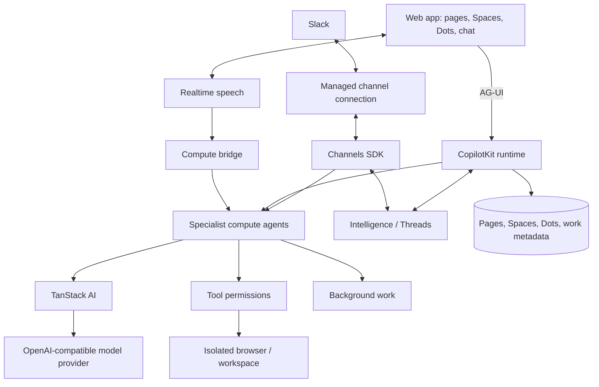

# OpenDots 项目说明（OpenDots README）

> 来源：https://github.com/CopilotKit/OpenDots/blob/main/README.md
> 原文：oss-repos/OpenDots/README.md
> 翻译日期：2026-11-03 ｜ 范围：全文 ｜ 方式：机器翻译初稿，未经人工校对
> 引用于：docs/essay-study/opendots-2026.md、docs/brief-plan.md §3/§3.1

## 目录

- [概览](#overview)
  - [Spaces（工作空间）](#spaces)
  - [Specialist Dots（专家 Dot）](#specialist-dots)
  - [Dot 的电脑](#dot-computers)
  - [保存前先审阅](#review-before-saving)
  - [Connections（连接）](#connections)
  - [已连接的应用](#connected-apps)
  - [文本与通话](#text-and-calls)
  - [Slack](#slack)
- [架构](#architecture)
  - [AG-UI：agent 与界面之间的桥梁](#ag-ui)
- [快速开始](#get-started)
- [数据与隐私](#data-and-privacy)
- [功能一览](#features)
- [扩展这个模板](#extending-the-template)
- [参与贡献](#contributing)
- [参考链接](#references)
- [许可](#license)
- [公共网络研究](#public-web-research)

<div align="center">

# OpenDots

### 全天候在线的 AI 同事，在文本、通话和 Slack 之间自如切换。

**一个用于构建持久化 AI agent 的开源模板，每个 agent 都拥有自己的电脑。提供 Web 与移动端。**

基于 [CopilotKit](https://github.com/CopilotKit/CopilotKit) 和 [AG-UI](https://docs.ag-ui.com/introduction) 构建。· [快速开始](#get-started) · [概览](#overview) · [架构](#architecture) · [功能](#features) · [参与贡献](CONTRIBUTING.md)

[](https://github.com/CopilotKit/OpenDots/actions/workflows/ci.yml)
[](./LICENSE)


<a href="https://trendshift.io/repositories/275323" target="_blank"></a>

把 OpenDots 部署在你自己的基础设施上。对话能力依赖 CopilotKit Intelligence：可以使用托管服务、[本地 Docker 评估环境](docs/SETUP.md#local-intelligence-evaluation)，或者带许可的[自托管部署](https://docs.copilotkit.ai/intelligence/self-hosting)。克隆这个模板，然后按需自由定制。

[**正在 OpenDots 之上做开发？与 CopilotKit 团队聊聊 →**](https://www.copilotkit.ai/talk-to-an-engineer?ref=opendots_readme)

</div>

---

<div align="center">

<table><tr><td>

https://github.com/user-attachments/assets/4c74fe7d-ecdd-42dd-95da-5d34f9b9576e

</td></tr></table>

</div>

_提问 → 浏览 → 批准 → 保存。实时的电脑画面和人工审阅卡直接出现在聊天里，批准后的草稿随即变成一个可编辑的 Space 页面。为便于观看已放大画面，空闲时间被剪掉，播放做了加速。_

<a id="overview"></a>

## 概览

OpenDots 是构建你自己的 agent 工作区的起点。克隆它，定义你的 Dot，接入你的服务，再按需要改造界面和工具。

**这是一个模板，不是托管产品。** 应用由你来运行，基础设施由你来配置。模板尚处于早期开发阶段；下方的"功能一览"会说明当前包含哪些能力，并区分"本地已验证"与"接入真实服务后才验证过"的部分。

<a id="spaces"></a>

### Spaces（工作空间）

Space 是工作文档的归宿。各个 Dot 在导航栏中单独列出，可以在各自的设置里被授予多个 Space 的访问权限。每个 Dot 都有一个默认的页面保存位置；已有安装会保留原先的 Space 访问权限。你可以在可搜索的资料库中浏览页面，在网格视图和列表视图之间切换，并把文档组织成层层嵌套的子页面。打开页面即可进入专注的可视化编辑器，支持格式化、slash commands 以及撤销/重做。你可以直接撰写，可以把一段对话保存成页面，也可以让某个专家来创建和修改内容。

页面保存在本地工作区数据库中。围绕页面的对话使用 CopilotKit Threads，每个页面与每位专家各对应一条独立会话。页面链接把文档工作区和 Dot 的聊天串联起来。在配置会话服务之前，手动编辑就能正常使用。自动保存会汇报进度，保存失败会保留你的草稿，修订检查则防止过期的修改覆盖更新的内容。Markdown 源码模式始终可用。

<div align="center">

<table><tr><td>

https://github.com/user-attachments/assets/d20c3405-4339-49e7-a799-43298728015c

</td></tr></table>

</div>

_打开一个 Space，进入它的启动简报，向 Scout 询问这个已保存的页面，然后回到 Dot 聊天继续。这段录屏使用的是真实的页面聊天和示例启动内容。_

<a id="specialist-dots"></a>

### Specialist Dots（专家 Dot）

给每个 Dot 一个名字、一个角色、一段指示说明，以及允许使用的工具。researcher 可以调研某个主题，writer 可以把研究发现写成草稿。你能检查它们的工作成果，也能控制它们各自能做什么。

<a id="dot-computers"></a>

### Dot 的电脑

每个 Dot 都可以拥有自己的电脑，底层使用 [OpenBot](https://github.com/CopilotKit/OpenBot) 的容器 supervisor 和 computer service。它的浏览器 profile 和工作区文件在停止/启动之间持续保留。Computer 面板提供浏览器控制、人工接管、文件、终端输出和活动记录；浏览器、文件与 shell 权限按 Dot 分别设置。应用把服务凭据留在服务器端，并为每个 Dot 派生一个各不相同的电脑凭据。

参见 [Computer setup](docs/COMPUTERS.md) 来构建这些固定版本的服务并接入你的部署。computer 工具依赖这些服务才能工作；未经配置的模板不会在你的宿主机上执行任何命令。

<div align="center">

<table><tr><td>

https://github.com/user-attachments/assets/30b691c3-0f66-4964-9fdb-67d4feab5568

</td></tr></table>

</div>

_让 Scout 打开一个网站、做总结、保存笔记并核对文件。这个演示中的每一步电脑操作都是通过聊天发起的；CopilotKit 的工具渲染器会把实时浏览器画面、已保存的文件和终端输出内嵌展示在聊天中。_

<a id="review-before-saving"></a>

### 保存前先审阅

你可以让 Dot 在保存之前先把草稿展示出来。CopilotKit 的 human-in-the-loop 卡片会暂停对话，等你选择 **Approve & save** 或 **Decline**。批准后会在你授权的 Space 中创建页面并返回链接；用同一份草稿重试会找回那个已保存的页面。草稿一旦改动，就需要重新审阅。你的决定做出之后，agent 会继续执行。

<a id="connections"></a>

### Connections（连接）

你可以让 Dot 使用任意 MCP server 提供的工具，比如邮件、日历、GitHub 或你自己的服务。只读工具可以自行运行，其他任何工具都会暂停，等待聊天中的 **Approve & run** 卡片——只有你批准后才会执行。每个工具都可以按 Dot 单独开关。参见 [Connections](docs/CONNECTIONS.md)。

<a id="connected-apps"></a>

### 已连接的应用

Dot 可以借助 [Composio](https://composio.dev) 使用 owner 的邮箱、日历等已连接应用。添加 `COMPOSIO_API_KEY` 后重启 OpenDots，然后在全局设置和该 Dot 的设置中都启用 Connected apps。仅添加 API key 本身并不会授予访问权限。

你也可以把每个 Dot 限制在指定的 toolkit slug 上，例如 `gmail` 或 `google_calendar`。toolkit 列表留空，则允许 Composio 项目下的全部 toolkit。OpenDots 用 `OWNER_ID` 标识 owner，因此绑定账号之后请保持这个值不变。当某个工具需要认证时，Dot 会在聊天中返回一个 Connect 链接，由 owner 完成服务商的登录流程。

这些工具操作的是真实账号。请先从只读请求开始，并使用测试账号，再尝试写操作。配置、权限、测试与数据共享的细节见 [Composio setup](docs/SETUP.md#composio)。

<a id="text-and-calls"></a>

### 文本与通话

连续的对话让 Dot 的头像和状态始终悬在消息上方，文本与通话控制触手可及。工作进展、来源链接和通话回执会出现在时间线中；侧面板则展示结果或 agent 的电脑画面。

通话把实时语音与一个独立的 compute agent 配对，这样在耗时较长的活儿运行时，对话仍可以继续。二者共用同一份对话上下文和同一套工具权限。通话界面包含实时计时器、你与 Dot 各自独立的字幕、麦克风静音、扬声器静音，以及一个可以回到聊天继续的最小化视图。语音功能需要单独配置服务商。

<div align="center">

<table><tr><td>

https://github.com/user-attachments/assets/3c06cf71-39ed-4e2b-b846-5463b2722389

</td></tr></table>

</div>

_接通、交谈、静音、最小化，再回到聊天。这是真实通话的无声录屏，等待时间已剪辑，播放已加速。_

<a id="slack"></a>

### Slack

通过托管的 Slack 连接（使用 Channels SDK）@ 到某个 Dot，然后在它的 thread 里继续对话。该集成遵循 [OpenTag](https://github.com/CopilotKit/OpenTag)，包含显式的 workspace/user 白名单，并需选定一位 specialist。接入你的部署见 [Slack setup](docs/SETUP.md#slack)。

<div align="center">

<table><tr><td>

https://github.com/user-attachments/assets/27d03a6c-a9e0-4c29-8d96-fafe0fbae20f

</td></tr></table>

</div>

用 [Channels SDK](https://github.com/CopilotKit/channels-sdk) 把你的 agent 带进 Slack。通过 CopilotKit Intelligence 接入它们，见 [managed Channels 文档](https://docs.copilotkit.ai/intelligence/channels)。

<a id="architecture"></a>

## 架构

<a id="ag-ui"></a>

### AG-UI：agent 与界面之间的桥梁

[AG-UI](https://docs.ag-ui.com/introduction) 在后端与 CopilotKit 组件之间承载流式消息、工具调用和 agent 状态。agent 干活时，电脑活动会内嵌显示出来；human-in-the-loop 卡片会在工具调用继续之前暂停它，等你做出决定。

模板使用 TanStack AI 负责模型流式输出与服务端工具执行，使用 CopilotKit 的 React SDK 与 runtime，用 Intelligence 提供持久的 Threads，用 Channels SDK 接入 Slack。页面、应用元数据与后台任务状态和会话历史分开存储。



你的部署需要自行配置 Intelligence 项目、模型服务商和 channel 连接；通话还需要语音服务商。凭据始终留在服务器端。配置缺失时应给出清晰的设置状态提示，测试 fixture 也应当与真实集成在界面上明显区分。

[OpenMuse](https://github.com/CopilotKit/OpenMuse) 和 [OpenBot](https://github.com/CopilotKit/openbot) 是持久化工作、agent 电脑与执行控制方面的代码参考。OpenDots 可以按你自己的工作流和部署选择进行改造。

<a id="get-started"></a>

## 快速开始

使用 **Node.js 24** 和 **npm**：

```sh
git clone https://github.com/CopilotKit/OpenDots.git
cd OpenDots
npm ci
cp .env.example .env
npm run dev
```

打开 **http://127.0.0.1:5173**。在接入任何服务之前，你就可以创建 Space、撰写页面、配置 Dot。要开始聊天，需要接入一个 Intelligence 项目和一个模型。

接入之前先想好会话存在哪里。做本地 Docker 评估，请按 [Local Intelligence evaluation](docs/SETUP.md#local-intelligence-evaluation) 操作；使用托管 Intelligence，则登录后在 `OpenDots` 文件夹下选择或创建一个项目：

```sh
npx copilotkit@latest login
npx copilotkit@latest project select
```

`project select` 会把项目 key 以 `CPK_INTELLIGENCE_API_KEY` 的形式写入 `.env`。请把这个自动生成的 `CPK_TELEMETRY_ID` 与该 key 一起保留，这样 SDK 的用量才能归到你的 Intelligence 账户名下。然后在 `.env` 中补上 `OPENAI_API_KEY` 和 `OPENAI_MODEL`，重启 `npm run dev`。

不要在这个文件夹里运行 `copilotkit onboard`。OpenDots 已经内置了 CopilotKit 集成，而 onboard 会再添加一套通用的集成。

配置、Slack、通话、浏览器服务和 Docker 见 [Setup](docs/SETUP.md)。

<a id="data-and-privacy"></a>

## 数据与隐私

对话消息、工具调用和运行事件会持久化到所配置的 Intelligence 部署中。托管方案把它们发到 CopilotKit 的云端；本地评估方案则使用运行在你机器上的 Intelligence。OpenDots 没有独立的 SQLite 会话存储；SQLite 单独保存页面、工作区元数据和 thread 绑定关系。

所配置的模型服务商会收到对话上下文，其中包含已授权的页面内容和工具结果。本地 Intelligence 并不意味着模型也在本地：应用模型和 Automatic Learning 模型需要分别配置。默认情况下，公共网络研究会把查询和选中的 URL 发给 Parallel；设 `WEB_SEARCH_PROVIDER=disabled` 可以禁用这些工具。启用已连接的应用后，工具参数和结果会经过 Composio 和应用服务商。语音与消息集成在使用时会把数据发给各自配置的服务商。

CopilotKit SDK 的遥测与会话持久化分开收集使用元数据。OpenDots 还会用一个随机安装 ID 记录有限的浏览器配置阶段和首次成功的 assistant 激活；同一套退出追踪开关也会关闭这类跟踪并清掉待发送的配置事件。参见 [browser setup telemetry](docs/SETUP-TELEMETRY.md)。运行时事件带有 `OpenDots` 标签，参见 [signup and usage tracking](docs/TELEMETRY.md)。设置 `COPILOTKIT_TELEMETRY_DISABLED=true` 或 `DO_NOT_TRACK=1` 可以退出追踪，参见 [CopilotKit telemetry](https://docs.copilotkit.ai/telemetry)。请查阅 [CopilotKit 隐私政策](https://www.copilotkit.ai/privacy-policy)，以及你所配置的每项服务的政策与数据保留设置。安装或续期本地 Intelligence 仍然需要 CopilotKit 登录和互联网连接。

<a id="features"></a>

## 功能一览

| 领域 | 已包含 |
| --- | --- |
| Spaces 与 Specialist Dots | 保存的名字、角色指示说明，以及按 Dot 划分的研究与记忆权限 |
| Pages | 可搜索的资料库、可视化编辑器、slash commands、自动保存、修订检查 |
| 会话 | React SDK 聊天与 Threads 集成、按页面区分的会话、来源链接 |
| Slack | 托管 Channels SDK 声明，含 workspace 与用户白名单 |
| 通话 | WebRTC 语音、委托计算、有时长上限的会话、挂断、时间线回执 |
| 后台任务 | 在原会话中执行的定时服务端轮次，带暂停与重试控制 |
| 浏览器 | 独立的只读公共页面服务，支持页面抓取并限制导航范围 |
| Dot 的电脑 | 按 Dot 划分的浏览器 profile、文件、shell、接管与操作记录，底层经由 OpenBot |
| Connections | 按 Dot 划分的 MCP server、Composio 已连接应用、按工具授权，以及 MCP 写操作的 owner 审批 |
| 外观 | 系统、浅色、深色主题；深色配色在构建时由浅色样式推导生成 |
| Memory | 由用户管理的偏好设置，获得许可的 Dot 可以使用 |
| Automatic Learning | 按 Dot 的 Learning 容器、会话证据路由、已发布技能投递；见 [setup](docs/SETUP.md#automatic-learning) |
| 部署 | 本地 Node 部署方式，以及分离的应用/浏览器容器 |

定时任务在原会话中运行。若 worker 在运行期间停止或租约过期，OpenDots 会把该次运行标记为 **Interrupted**，并等待显式的重试。请先审阅它的页面和电脑操作，再视情况使用 **Retry after review**。即使某次运行没有最终结果，它的副作用可能已经生效。

本地检查覆盖了配置、持久化、权限、SDK 失败处理和浏览器隔离。自动化测试使用服务 fixture。**真实的 Intelligence、模型响应和页面上下文聊天已于 2026 年 9 月 29 日验证。** 真实的 OpenBot 电脑浏览、文件创建、shell 验证，以及停止/启动之间的文件持久化也已在本地验证。真实的 Realtime 语音、通话控制和回执持久化已于 2026 年 9 月 30 日在本地验证。Slack 与语音 compute 委托仍需接入真实服务后再验证。演示流程及其边界见 [recording notes](docs/demos/README.md)。

Automatic Learning 的路由与技能投递已在本地配置完成。云端调度、符合条件的 thread 数量以及已发布技能的投递，仍需接入真实服务后验证。技能需要在 Intelligence 中经过审阅并发布；没有容器的既有会话不会被追溯纳入。

这是一个单 owner 的起点。多人共同编辑、邀请、文件上传和交互式页面嵌入暂不包含。调度只是一组重复执行的指令，并非完整的目标或事件触发系统。Specialist Dots 各有各的角色和会话；多 Dot 群聊与自动分工是后续工作。

<a id="extending-the-template"></a>

### 扩展这个模板

- 为多用户部署补充身份、Space 成员关系和页面协同编辑。
- 增加文件附件和更丰富的页面内容。
- 增加事件触发器和持久的职责生命周期。
- 为自己的工作流扩展工具与审批流程。
- 增加更丰富的产出物、已连接应用的上下文，以及 specialist 之间的协作。

<a id="contributing"></a>

## 参与贡献

开发指引见 [Contributing](CONTRIBUTING.md)，问题报告见 [Security](SECURITY.md)。贡献应说明它实现了什么工作流、附上验证证据，并把真实集成与 fixture 区分开来。

<a id="references"></a>

## 参考链接

- [AG-UI documentation](https://docs.ag-ui.com/introduction)
- [CopilotKit documentation](https://docs.copilotkit.ai/intelligence/overview)
- [Channels SDK](https://github.com/CopilotKit/channels-sdk)
- [OpenMuse](https://github.com/CopilotKit/OpenMuse)
- [OpenBot](https://github.com/CopilotKit/openbot)
- [OpenTag](https://github.com/CopilotKit/OpenTag) —— Channels SDK 集成参考

<a id="license"></a>

## 许可

[MIT](LICENSE)。

<a id="public-web-research"></a>

## 公共网络研究

在真实研究和 Dot 对话中，默认选中的是 Parallel。只给一个主题问题，它会发现并阅读最多五个来源；也可以直接给出 URL 让它抓取。来源会连同链接一起保存。这条研究路径不需要浏览器 worker；computer tools 仍然可用于交互式工作。

`WEB_SEARCH_PROVIDER=browser` 保留既有的仅限 URL 的浏览器读取器，`WEB_SEARCH_PROVIDER=disabled` 则禁用这些研究工具。工作区与 Dot 的研究权限、暂停和取消控制依然生效。示例研究内容为虚构，不会联系任何服务商。

查询、请求的 URL、一个稳定的会话标识和研究目标会被发送到 `https://search.parallel.ai/mcp`。记忆和完整对话不会自动转发给 Parallel。模型选出的研究目标里仍可能带有对话上下文。该匿名服务对轻量使用免费，配额由服务商管理；生产环境或需要更高配额时，请在服务器上设置 `PARALLEL_API_KEY`。服务商报错或结果为空时会如实上报，不会用编造的证据顶替。参见 [Parallel Search MCP documentation](https://docs.parallel.ai/integrations/mcp/search-mcp)。


