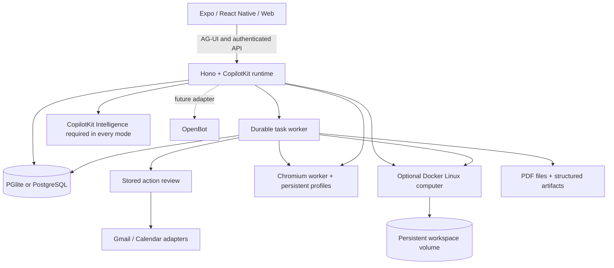

# OpenMuse 项目 README（OpenMuse README）

> 来源：https://github.com/CopilotKit/openmuse/blob/main/README.md
> 原文：oss-repos/openmuse/README.md
> 翻译日期：2026-11-03 ｜ 范围：全文 ｜ 方式：机器翻译初稿，未经人工校对
> 引用于：docs/essay-study/openmuse-2026.md、docs/brief-plan.md §3/§3.1

**目录**

- [演示](#演示)
- [它是什么](#它是什么)
- [特性](#特性)
- [快速开始](#快速开始)（含「试一试」）
- [部署到 Render](#部署到-render)（含「首次运行」「服务」）
- [配置 agent 与 Google](#配置-agent-与-google)
- [公网网页搜索](#公网网页搜索)
- [浏览器 worker](#浏览器-worker)
- [持久化与运行](#持久化与运行)（含「Linux 终端与工作区」「应用存储」）
- [CopilotKit Rich Threads](#copilotkit-rich-threads)
- [注册与运行时追踪](#注册与运行时追踪)
- [架构](#架构)（含「OpenBot 兼容性」）
- [开发](#开发)
- [贡献与许可](#贡献与许可)

  <div align="center">

# OpenMuse

**一个自带浏览器、终端、文件，而且关掉 App 也照常干活的个人 agent。兼容任何 agent harness。**

说出你想要的结果，跟着计划走、审阅关键操作，最后回来拿成果。
基于 CopilotKit React Native 构建，支持 iOS、Android 和 web。

[快速开始](#快速开始) · [演示](#演示) · [特性](#特性) · [架构](#架构) · [文档](docs/README.md) · [贡献](CONTRIBUTING.md)

[](https://github.com/CopilotKit/OpenMuse/actions/workflows/ci.yml)
[](LICENSE)

<a href="https://trendshift.io/repositories/254992?utm_source=trendshift-badge&amp;utm_medium=badge&amp;utm_campaign=badge-trendshift-254992" target="_blank" rel="noopener noreferrer"></a>

[](https://render.com/deploy?repo=https://github.com/CopilotKit/OpenMuse)

克隆这个模板，想怎么改就怎么改。

**[正在 OpenMuse 之上做东西？和 CopilotKit 团队聊聊 →](https://www.copilotkit.ai/talk-to-an-engineer?ref=openmuse_hero)**

https://github.com/user-attachments/assets/8014d185-346c-4954-8ff0-26c582c5093a
https://github.com/user-attachments/assets/0cc87de0-c3c1-4f24-b7df-e7d04bb946fd

</div>

> **Alpha 版，面向自托管与在其上构建。** 开放式推理、真实 Google 账号接入和 CopilotKit Rich Threads 都需要各自单独配置。哪些能力已经验证过见[验证说明](docs/VERIFICATION.md)，整体规划见[路线图](ROADMAP.md)。

## 演示

在 iPhone 上，让 OpenMuse 去 Hacker News 找几条有意思的故事，并总结 CopilotKit。在桌面上，让它查一下学校出游的邮件、打开那封信，再去研究蒙特雷湾水族馆的展品。agent 会把邮件和浏览器的结果直接嵌在对话里显示。需要亲自上手时，点 **Take control（接管）** 就会打开同一个浏览器会话。

那条 38 秒的 iPhone 演示和 42 秒的桌面 web 演示展示的是当前界面，画幅为 16:9。agent 回复期间，输入框里的发送箭头会变成停止方块，回复结束后再变回去；中途停止也不会丢掉你已输入的草稿。模型配置和复现步骤见[录制说明](docs/DEMO.md)。

[Mobile MP4](https://github.com/user-attachments/assets/8014d185-346c-4954-8ff0-26c582c5093a) · [Web MP4](https://github.com/user-attachments/assets/0cc87de0-c3c1-4f24-b7df-e7d04bb946fd) · [录制细节与复现](docs/DEMO.md)

[Jev 水族馆之旅演示](docs/demos/jev-generative-ui.md)走了一遍虚构的学校邮件、澄清式选项、带出处的展品卡片、动手偏好微调，以及最终确认的选择。[观看 83 秒的 Jev 实况录制](assets/demos/2026-09-23/jev-live-web.mp4)：由 TypeSafe Jev 做决策，另有一个脚本化 agent 保证出游场景可重复。另有[脚本化决策示例录制](assets/demos/2026-09-23/jev-web.mp4)可看。

## 它是什么

OpenMuse 是一个个人 agent 应用：它有一台属于自己的计算机、可见的工作过程，以及丰富的结果。它自带服务端、任务 worker 和浏览器 worker。源码在 MIT 许可下，你可以查看并修改。

这台计算机由**常驻的 Chromium 加一个可选的 Linux 工作区**组成。agent 可以浏览公开网页、在自己的容器里执行命令、处理文件，还能在计算机和应用之间来回传 PDF。你随时可以打开它的浏览器或终端接着干活。图形化桌面和全自动下单仍是未来工作。

## 特性

| 界面 | 这个 alpha 版本里能跑什么 |
| --- | --- |
| **Chat** | CopilotKit 无头聊天，流式 AG-UI 事件；邮箱搜索与阅读；发送/停止共用一个输入胶囊；可见的后续任务队列；草稿保留；委派任务；以及内嵌的邮件、浏览器、PDF、计划、理财卡片。 |
| **Agent computer** | 常驻浏览器 profile 与接管控制台；可选的隔离 Linux 终端、保存的命令回执、可编辑的工作区文件、PDF 传输。 |
| **Activity** | 可持久化的任务计划、进度、输入请求、暂停/恢复/取消/重试、审批，以及保存的回执。SQL 租约机制可恢复被打断的工作。 |
| **Ideas** | 带出处证据的建议；可编辑、接受或忽略。已发出的回复和已完成的同类工作不会重复出现。 |
| **Goals & Tracking** | 目标与里程碑；对公开网页做周期性检查（内容变化、可访问性、USD 价格阈值），告警去重并带失败退避。 |
| **Documents** | 邮件附件 → PDF → 按需填表 → 填好的副本 → 审阅后的回复 → 回执。原生/web PDF 查看、翻页、缩放、受支持字段与分享。 |
| **Finance** | 导入交易 CSV，生成带分类、交易流水和储蓄目标行动的支出摘要。 |
| **Gmail & Calendar** | Google OAuth 适配器、完整邮件会话、草稿/附件、日历发现，以及经审阅的事件创建/更新/删除。需要真实凭据。 |
| **Personal context** | 可编辑的姓名、语气、头像与记忆。后台更新偏好和持久的应用内通知。 |
| **Rich Threads** | CopilotKit Intelligence 在每种模式下的持久化：稳定的主对话、侧边聊天、重命名、归档、恢复与回放。需要一个仅服务端的 project key。 |

[特性清单](docs/FEATURES.md)说明了已实现的能力和计划中的扩展。健康/银行/社交连接器、设备推送、语音、生成式可执行工具，以及自动预订/支付都在[路线图](ROADMAP.md)上。

## 快速开始

**环境要求：** Node 24 LTS、pnpm 11.19.0，以及一个 CopilotKit Intelligence project key。本地示例应用不需要模型、Google 账号或 Docker。

```sh
git clone https://github.com/CopilotKit/OpenMuse.git openmuse
cd openmuse
pnpm install --frozen-lockfile
cp .env.example .env
npx copilotkit@latest login
npx copilotkit@latest project select
# Set CPK_INTELLIGENCE_API_KEY in .env to the generated server-only project key.
# Keep the CLI-generated CPK_TELEMETRY_ID too, including in deployed server environments.
pnpm dev
```

在另一个终端里：

```sh
pnpm dev:web
```

打开 [localhost:8081](http://localhost:8081)。API 运行在 [localhost:8787/api/health](http://localhost:8787/api/health)。

### 试一试

1. 在 Chat 里发送 **“Complete the permission slip（完成知情同意表）”**。打开任务，填入虚构的表单值，查看保存下来的 PDF，再审阅拟好的回复。这只会写入本地邮箱。
2. 在 **Goals → Track** 里创建一个内置的可用性监控，然后改一下内置测试页来触发告警。
3. 在 **Menu → Delegate task → Finance** 里用 **Try example transactions** 创建一个可交互的支出跟踪器。
4. 启动[浏览器 worker](#浏览器-worker) 并配置模型，然后问 **“Check out Hacker News for cool stuff（去 Hacker News 看看有什么好东西）”** 或 **“Summarize copilotkit.ai（总结 copilotkit.ai）”**。可以内嵌跟随浏览器画面，用 **Take control** 打开它的会话。想跑这个流程但不接模型，就照[AI Mock 演示设置](docs/DEMO.md#run-the-agent-browser-demo)来做。

iOS 或 Android 用 `pnpm --dir apps/mobile ios` 或 `pnpm --dir apps/mobile android`，需要 Xcode 或 Android 工具链。PDF 阅读器需要 Expo development build，参考[原生端设置](apps/mobile/README.md)。

## 部署到 Render

[](https://render.com/deploy?repo=https://github.com/CopilotKit/OpenMuse)

[render.yaml](render.yaml) 会部署三个服务：API、web 应用和一个私有浏览器。API 对 `/` 返回 JSON，所以 UI 就是它自己的静态站点。

### 首次运行

1. 点 **Deploy to Render**，等 `openmuse-api`、`openmuse-web` 和 `openmuse-browser` 都上线。
2. 在 `openmuse-api` 上打开 **Environment**，复制 `OPENMUSE_ACCESS_KEY`。
3. 打开 `openmuse-web` 的网址，用这把 key 登录。
4. 发一条消息。

部署表单需要你提供三个值，另外两个由 Render 生成。

| 变量 | 谁来设置 | 缺失会怎样 |
|---|---|---|
| `CPK_INTELLIGENCE_API_KEY` | 你。先运行 `npx copilotkit@latest login`，再运行 `npx copilotkit@latest project select`。要留在服务端。 | Chat 打不开会话（thread）。 |
| `CPK_TELEMETRY_ID` | 你。保留同一次 project selection 生成的身份标识。 | 运行时用量无法归属到 Intelligence 注册账号。 |
| `OPENAI_API_KEY` | 你。默认模型 `openai/gpt-5` 会用到它。要换 Anthropic 或 Google 就改 `MODEL` 并提供对应的 provider key。 | 模型调用失败。 |
| `OPENMUSE_ACCESS_KEY` | Render | 无法登录。 |
| `TOKEN_ENCRYPTION_KEY` | Render | API 在 live 模式下拒绝启动。 |

健康检查：`https://<openmuse-api>/api/health`。

### 服务

| 服务 | 套餐 | 跑什么 |
|---|---|---|
| `openmuse-api` | Standard，`/var/data` 挂 1 GB 磁盘 | Hono API 和进程内的任务 worker。`DATA_DIR` 为 `/var/data/openmuse`。 |
| `openmuse-web` | 静态站点 | Expo 的 web 导出产物。`EXPO_PUBLIC_API_URL` 在构建时固化进去。 |
| `openmuse-browser` | 私有服务，Standard，`/data` 挂 1 GB 磁盘 | Playwright 和 Chromium。API 通过私有网络访问它。 |

**Standard** 是能保持在线的最小套餐。用 512 MB 的话，进程还没绑上端口就会耗尽内存，因为 PGlite 会加载一份内嵌的 Postgres。

**磁盘**用来放数据库、PDF 和签名密钥。重新部署时不带磁盘会把这些数据清掉。聊天会话由 CopilotKit Intelligence 存储，所以即使从未挂过磁盘，重新登录后会话依然能加载出来。

**必须是 live 模式。** Render 绑定的是 `0.0.0.0`，而示例模式会拒绝一切非 loopback 的主机。Blueprint 里已设置 `WORKSPACE_MODE=live`。

**浏览器是随附的，也可以拿掉。** `openmuse-browser` 是私有服务，没有公网 URL。API 通过 Render 生成的 token 访问 `http://openmuse-browser:8790`。如果私有主机名不叫 `openmuse-browser`，就把 `BROWSER_WORKER_URL` 设为 `http://<那个主机名>:8790`。不想部署它，就删掉 `openmuse-browser` 服务，以及 `openmuse-api` 上的 `BROWSER_WORKER_URL` 和 `WORKER_TOKEN` 两项。聊天、草稿和任务照常运行，只是页面读取、截图和 **Take control** 不可用。

Docker 计算机以及 Google 邮件/日历需要下面几节的配置，这个 Blueprint 不会替你启动它们。

## 配置 agent 与 Google

把 [.env.example](.env.example) 里带注释的设置抄进你私有的 `.env`：

1. 设置 `AGENT_BACKEND=model`、`MODEL=provider/model-id` 和对应的 provider key。CopilotKit 支持已配置的 OpenAI、Anthropic 或 Google 提供方。虚构数据也可以搭配真实模型使用。provider key 只留在服务端。
2. 用 `npx copilotkit@latest login` 和 `npx copilotkit@latest project select` 创建或选择一个 CopilotKit Intelligence 项目，把生成的 `CPK_INTELLIGENCE_API_KEY` 留在服务端。
3. 要用个人邮件/日历，设置 `WORKSPACE_MODE=live`、生成的 `CPK_INTELLIGENCE_API_KEY`、一个至少 24 字符的随机 `OPENMUSE_ACCESS_KEY`，以及 `TOKEN_ENCRYPTION_KEY`——内容是 32 字节随机数的 base64 编码。然后重启 API。
4. 配置一个启用了 Gmail 和 Calendar API 的 Google OAuth Web 客户端。设置 `GOOGLE_CLIENT_ID` 和 `GOOGLE_CLIENT_SECRET`，并把 `${PUBLIC_API_URL}/api/google/callback` 注册为它的 redirect URI。在你的 Google 项目里配置好同意屏幕/测试用户访问。
5. 打开 **Apps → Gmail**（或 **Google Calendar**），先连接读取权限，需要时再授予写入权限。每一次发送或日历变更仍要经过各自已保存的审阅流程。更换/断开账号会使待处理的、与该连接绑定的工作失效。

Google 凭据在静态存储时是加密的。文件 URL 和浏览器控制台使用短时效签名。这套部署由一个所有者加一把共享访问 key 保护，它不是多租户认证系统。远程主机请使用 HTTPS 和受限网络访问；本地数据模式请保持在 loopback 上。

## 公网网页搜索

网页搜索默认开启。在 API 和任何独立的任务 worker 上设置 `WEB_SEARCH_ENABLED=false` 可以关闭。配置好模型后，委派任务和内置的模型聊天（`AGENT_BACKEND=model`）会使用 [Parallel 免费、无需 key 的 Search MCP](https://docs.parallel.ai/integrations/mcp/search-mcp) 作为内置搜索提供方。例如可以问：“Find the official CopilotKit React Native setup instructions and cite the sources.（找出 CopilotKit React Native 的官方安装说明并引用来源。）”结果里包含来源 URL 和摘录；委派任务会把它们保存为证据。脚本化的示例聊天和外部 AG-UI 对话仍沿用它们原有的工具。

搜索会把模型生成的查询和上下文（可能包含你对话或任务中的信息），外加每个聊天/任务一个的随机会话标识符发送给 Parallel。详见 [Parallel 隐私政策](https://parallel.ai/privacy-policy)。免费额度有限流；失败会如实报告，不会降级到付费方案。停止聊天或中断任务会取消它进行中的搜索。

## 浏览器 worker

在 `.env` 里设置 `BROWSER_WORKER_URL=http://127.0.0.1:8790`，以及一个至少 32 字符的随机 `WORKER_TOKEN`。

```sh
pnpm --dir apps/worker exec playwright install chromium
pnpm dev:browser
```

也可以用 `docker compose --env-file .env -f infra/compose.yaml up --build -d`。同一个 token 必须能同时到达 API 和 worker。会话使用常驻的 Chromium profile；应用可以打开一个实时截图控制台，还能导入 PDF 下载。agent 工具可以读取公开页面，并把交互性工作交回给人。[worker 的设置与边界](apps/worker/README.md)。

## 持久化与运行

### Linux 终端与工作区

先构建计算机镜像，在 API 上启用它，然后打开 **Computer → Terminal → Start computer**：

```sh
docker build -t openmuse-computer:local apps/computer
COMPUTER_ENABLED=true pnpm dev
```

API 需要能访问 Docker CLI 和引擎。命令在一个非 root 容器里执行，不挂载宿主目录、不带凭据。命名卷 `/workspace` 会在停止后保留文件。终端网络是禁用的；访问公网网页走浏览器 worker。命令有 30 秒时限，输出/退出码会被保存成回执。**Files** 支持文件夹、文本编辑，以及与 Documents 之间互传 PDF。这是一个 Linux 容器，不是完整的操作系统虚拟机。[设置、Colima 方案与边界](docs/COMPUTER.md)。

### 应用存储

默认情况下，内嵌的 PGlite、文档和签名密钥放在 `.openmuse/`；浏览器 profile 放在 `.openmuse/browser-profiles/`。请把这个目录设为私有并做好备份。API 托管任务 worker；宿主进程必须保持运行，后台工作才会继续。

要拆出独立的任务 worker，两个进程需配置相同的 `DATABASE_URL`、密钥和共享的 `DATA_DIR`，然后在 API 上设置 `TASK_WORKER_ENABLED=false` 并运行 `pnpm dev:worker`。PGlite 无法被多个进程同时打开。生产环境命令是 `pnpm build:server`、`pnpm start` 和 `pnpm start:worker`。API 只跑一个实例；任务 worker 之间通过 SQL 租约协调。

外部写入结果不确定时，不会发生隐式的重试。先确认提供方的结果，再决定是否创建替代操作。暂停/取消会阻止后续任务步骤；已经批准、正在途中的提供方请求可能会完成。

## CopilotKit Rich Threads

每一次部署都需要在 API 服务端配置 `CPK_INTELLIGENCE_API_KEY`，用于 CopilotKit Intelligence 的会话持久化与回放。用 `npx copilotkit@latest login` 和 `npx copilotkit@latest project select` 创建或选择项目，设置好生成的仅服务端 key，然后重启 API。原生菜单使用 `useThreads`；富文本工具结果会链回已保存的任务、文档和浏览器会话。

Intelligence 是一项独立服务，不在本仓库的 MIT 许可范围内，仓库也不附带任何 project key。[配置与验证边界](docs/RICH-THREADS.md)。

## 注册与运行时追踪

CopilotKit SDK 通过共享的 CopilotKit sink 把运行时遥测发送到 PostHog，并带上 `accessibility_title: "OpenMuse"`。遥测默认全量采集；SDK 显式关闭和采样设置优先级更高。部署时请把 CLI 生成的 `CPK_TELEMETRY_ID` 和仅服务端的 project key 一起保留。Intelligence 单独记录已完成的账号注册；在 sink 解析出身份之后，OpenMuse 的运行时用量可以与这些账号关联起来。[设置、关闭方式与 PostHog 验证](docs/TELEMETRY.md)。

## 架构



| 目录 | 用途 |
| --- | --- |
| `apps/mobile` | iOS、Android、web 共用的 UI，基于 CopilotKit 无头 hooks。 |
| `apps/server` | API、CopilotKit runtime、身份边界、任务引擎、审阅、文件与持久化。 |
| `apps/worker` | 带 token 保护、使用常驻 profile 的 Playwright 浏览服务。 |
| `apps/computer` | 非 root 的 Linux 镜像、受限的文件系统辅助程序，以及真实的容器验证。 |
| `packages/domain` | 共享类型与请求校验。 |
| `packages/integrations` | Google 与浏览器协议适配器。 |
| `packages/backends` | 可选的 OpenBot HTTP 适配器及其身份边界。 |
| `tests` | 工作流、运行时、持久化、提供方契约与授权测试。 |

### OpenBot 兼容性

OpenMuse 的原生客户端和 personal-agent 工作流与 OpenBot 相互独立。默认禁用的 OpenBot 适配器被固定版本，并针对上游接口做契约测试。实时的用户/会话桥接、常规映射以及计算机后端接线仍是未来工作。OpenBot 的 Intelligence runtime 不是一个裸的 AG-UI endpoint。[集成契约](docs/OPENBOT-INTEGRATION.md)。

## 开发

```sh
pnpm lint
pnpm typecheck
pnpm test
pnpm build:server
pnpm build:web
pnpm build:ios
pnpm build:android
pnpm --dir apps/worker typecheck
pnpm test:browser
pnpm test:computer
```

各平台的构建脚本导出的是 JavaScript/Hermes bundle，并不会产出已签名的应用二进制。浏览器检查使用受控的 HTTP fixture；本地检查需要已安装的 Chromium，容器检查则需要 Docker 以及访问 registry 来构建镜像。CI 还会运行浏览器和 Linux 计算机容器的测试。参见[贡献指南](CONTRIBUTING.md)和[验证结果](docs/VERIFICATION.md)。

## 贡献与许可

欢迎提 issue 和 pull request。先看 [CONTRIBUTING.md](CONTRIBUTING.md)、[ROADMAP.md](ROADMAP.md) 和[安全策略](SECURITY.md)。

MIT 许可。由 CopilotKit 构建，其原始界面和虚构素材一并包含在内。网站、邮件和文档内容提供的是证据，而不是行动的许可。
